<div align="center">


# MUKEN STORE

**BEYOND EVERY LIMIT.**

E-commerce conceitual premium de tecnologia, moda, acessórios e lifestyle,<br>
desenvolvido com HTML5, CSS3 e JavaScript Vanilla usando a metodologia **Vibe Coding**.

[**🌐 Acessar a loja**](https://jpribeiro011.github.io/muken-store/) ·
[**📁 Repositório**](https://github.com/JpRibeiro011/muken-store) ·
[**📄 Relatório técnico**](docs/relatorio.md) ·
[**🧠 Histórico de prompts**](docs/historico-prompts.md)


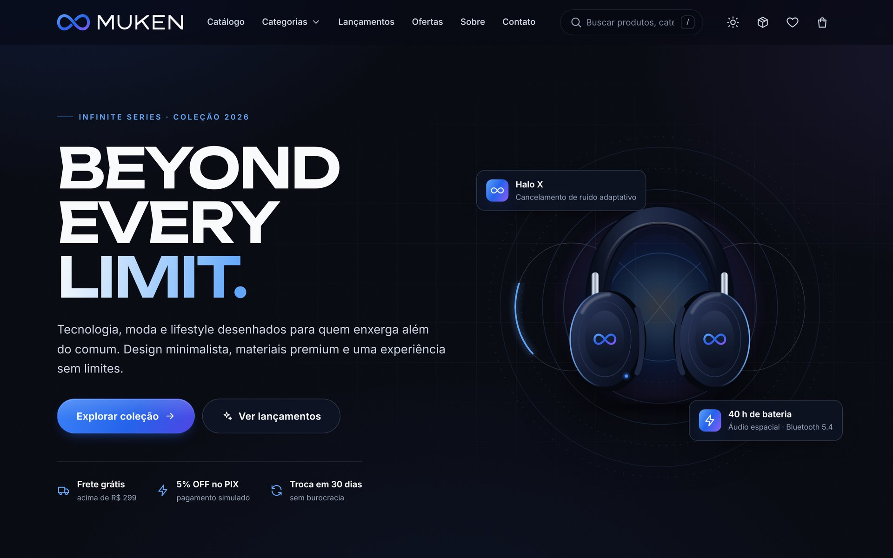

</div>

---

## Sumário

- [Sobre o projeto](#sobre-o-projeto)
- [Objetivo](#objetivo)
- [Identidade da marca](#identidade-da-marca)
- [Tecnologias utilizadas](#tecnologias-utilizadas)
- [Funcionalidades](#funcionalidades)
- [Capturas de tela](#capturas-de-tela)
- [Estrutura de pastas](#estrutura-de-pastas)
- [Como executar localmente](#como-executar-localmente)
- [Testes automatizados (opcional)](#testes-automatizados-opcional)
- [Versionamento com Git](#versionamento-com-git)
- [Publicação no GitHub Pages](#publicação-no-github-pages)
- [Informações acadêmicas](#informações-acadêmicas)

---

## Sobre o projeto

A **MUKEN STORE** é uma loja virtual conceitual com identidade visual própria, premium, minimalista e futurista. O nome **MUKEN** faz referência ao conceito de **infinito** presente no universo de *Jujutsu Kaisen* (associado ao personagem Satoru Gojo). Essa inspiração foi traduzida em uma identidade **totalmente original**: nenhum personagem, logotipo, imagem ou arte oficial da franquia foi utilizado.

A loja é um site estático (sem backend) e **todas as funcionalidades são reais**: catálogo, pesquisa, filtros combinados, carrinho com cálculos e controle de estoque, cupons, checkout com validação, pagamentos simulados, histórico de pedidos, favoritos e tema claro/escuro, com persistência em LocalStorage.

> ⚠️ **Projeto acadêmico.** Produtos, preços, avaliações e pedidos são fictícios. Nenhuma venda, cobrança ou entrega real é realizada e **nenhum dado real de cartão é solicitado**.

## Objetivo

Desenvolver um e-commerce conceitual funcional, bem documentado e com aparência profissional, demonstrando domínio de HTML5, CSS3, JavaScript Vanilla, LocalStorage, Git, GitHub e GitHub Pages, além do uso produtivo de Inteligência Artificial por meio do Vibe Coding.

## Identidade da marca

| Conceito | Tradução visual |
| --- | --- |
| **Infinito** | Símbolo de infinito entrelaçado, com um vazado real que cria profundidade |
| **Seis Olhos / visão** | Azul elétrico e azul luminoso como cores de destaque, brilhos e contornos de luz |
| **Vazio Ilimitado** | Fundos quase pretos, anéis concêntricos, grade em perspectiva e gradientes sutis |
| **Energia** | Luz percorrendo o infinito no hero, faixa de rolagem infinita e microinterações |

**Paleta:** `#080A12` preto profundo · `#10182B` azul marinho · `#2563EB` azul elétrico · `#60A5FA` azul luminoso · `#F8FAFC` branco gelo · `#94A3B8` cinza · `#8B5CF6` roxo de destaque.
**Tipografia:** Unbounded (títulos) e Inter (textos), hospedadas no próprio projeto (licença SIL OFL).
**Logotipo:** versões horizontais para fundo escuro e claro, símbolo isolado e favicon, em [`assets/logo/`](assets/logo) e [`assets/icons/`](assets/icons).

## Tecnologias utilizadas

| Tecnologia | Uso no projeto |
| --- | --- |
| **HTML5** | Estrutura semântica, landmarks, `<dialog>` nativo, formulários acessíveis |
| **CSS3** | Design tokens com variáveis, Grid/Flexbox, temas claro e escuro, animações, `@media` |
| **JavaScript Vanilla** | Roteador SPA por hash, componentes, regras de negócio, validações, eventos |
| **LocalStorage** | Carrinho, cupom, favoritos, pedidos, estoque, tema, perfil, mensagens |
| **SVG** | Logotipo, ícones e 20 ilustrações de produtos originais |
| **Git / GitHub** | Versionamento com commits organizados por etapa |
| **GitHub Pages** | Hospedagem estática gratuita |
| **Playwright + axe-core** | Testes automatizados e auditoria de acessibilidade (opcionais, fora do site) |

Nenhum framework (React, Vue, Angular etc.) foi utilizado.

## Funcionalidades

**Loja e catálogo**
- Página inicial com hero, faixa de benefícios infinita, categorias, destaques, oferta com contagem regressiva real, carrossel de lançamentos, ranking de mais vendidos, manifesto e “vistos recentemente”.
- 20 produtos fictícios em 4 categorias, cada um com ID, nome, categoria, descrição, preço, preço promocional, imagem, estoque, avaliação e disponibilidade.
- **Pesquisa** por nome sem diferenciar acentos/maiúsculas, com sugestões em tempo real (setas + Enter).
- **Filtros simultâneos:** categoria, faixa de preço, promoção, lançamentos e disponibilidade; **ordenação** por menor preço, maior preço, A–Z, Z–A, avaliação, mais vendidos e lançamentos. O estado fica na URL (links compartilháveis).
- Página do produto com zoom, desconto, parcelamento, preço no PIX, estoque, quantidade, abas (descrição, especificações, avaliações), cálculo de frete por CEP e produtos relacionados.
- Visualização rápida em modal e skeleton loading no primeiro carregamento.

**Carrinho e checkout**
- Adicionar, remover (com **desfazer**), aumentar e diminuir, edição direta da quantidade e **bloqueio acima do estoque**.
- Subtotal, descontos, cupom, frete (grátis acima de R$ 299), total e quantidade de itens.
- **Cupons fictícios:** `MUKEN10`, `INFINITO15` (a partir de R$ 500), `BEYOND50` (a partir de R$ 350) e `FRETEZERO`.
- Checkout em 3 etapas com máscaras e validação acessível; **CPF validado pelos dígitos verificadores** e botão para gerar um CPF de teste; endereço pelo CEP (ViaCEP, opcional).
- **PIX simulado** (5% OFF, QR Code ilustrativo), **cartão simulado** (apenas cartões de teste; um deles simula recusa) e **boleto demonstrativo**.
- Número de pedido fictício, tela de sucesso, baixa de estoque e **histórico de pedidos** com status que evolui com o tempo e “comprar novamente”.

**Experiência e extras**
- Favoritos persistentes, tema claro/escuro (escuro é o padrão), sincronização entre abas.
- Notificações personalizadas, animações de entrada, efeitos de profundidade (parallax), botão “voltar ao topo”.
- Páginas Sobre (identidade visual com paleta copiável), Contato (formulário validado com protocolo e FAQ), Política de Privacidade (com exclusão real dos dados do navegador) e 404.
- Acessibilidade: navegação completa por teclado, foco gerenciado, ARIA, contraste AA nos dois temas, `prefers-reduced-motion`.
- Responsivo de 320 px a telas grandes; funciona também abrindo o `index.html` diretamente (`file://`).

## Capturas de tela

| Página inicial (tema claro) | Catálogo com filtros simultâneos |
| --- | --- |
| 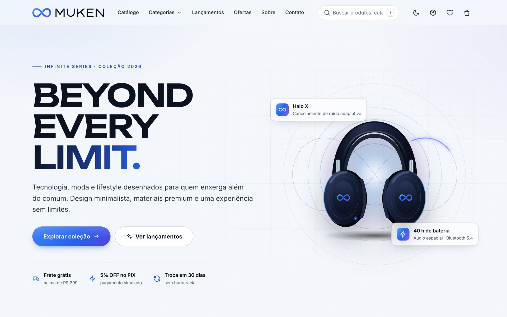 | 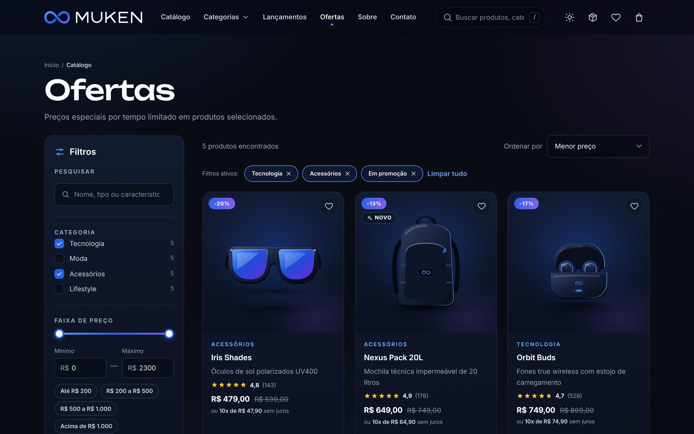 |
| **Detalhes do produto** | **Visualização rápida** |
| 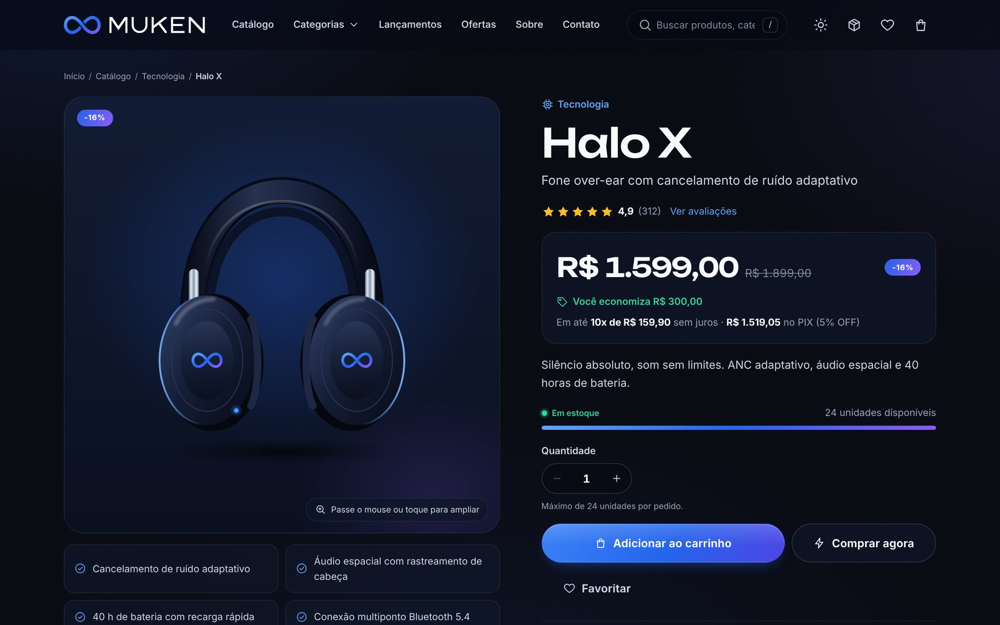 | 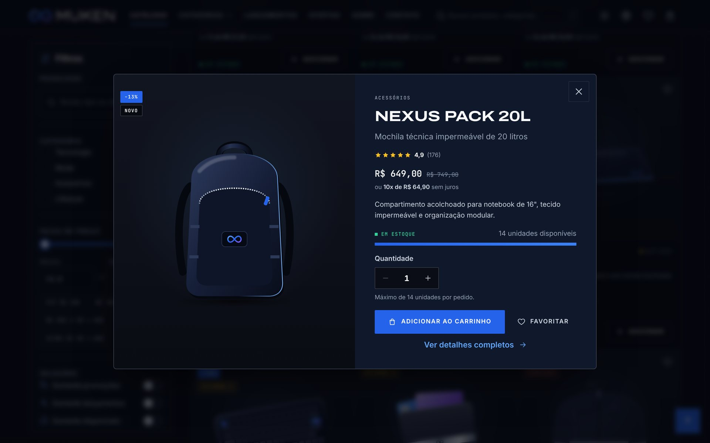 |
| **Carrinho com cupom** | **Checkout — pagamento** |
| 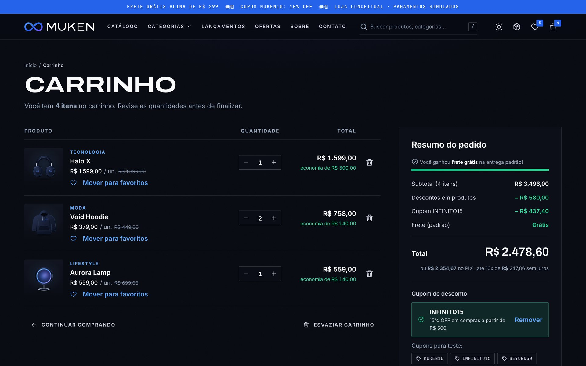 | 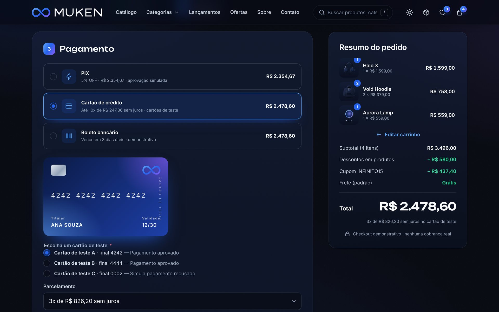 |
| **Pedido confirmado (PIX)** | **Histórico de pedidos** |
|  | 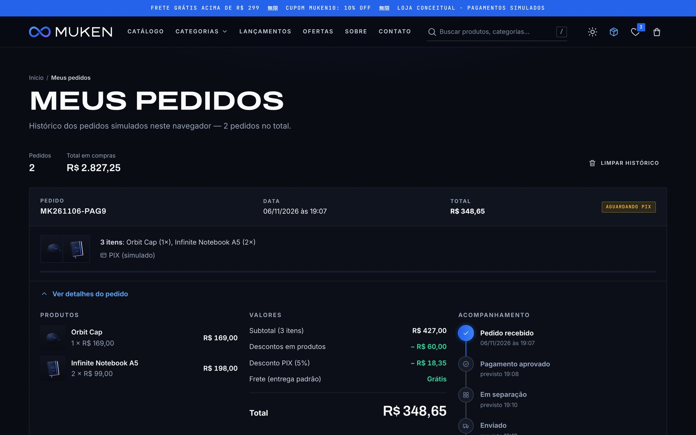 |
| **Identidade visual** | **Privacidade e dados locais** |
| 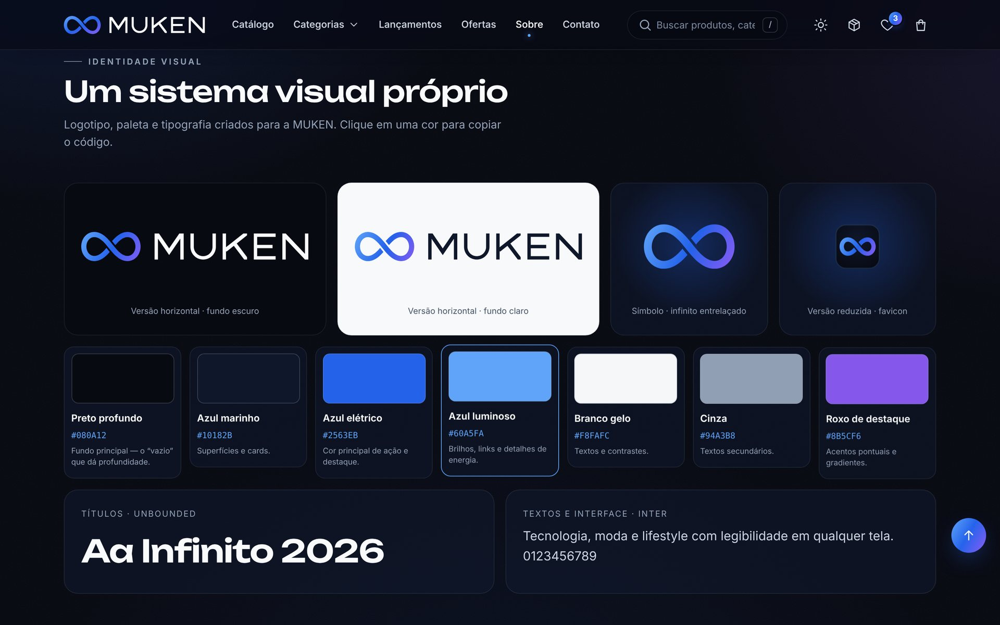 | 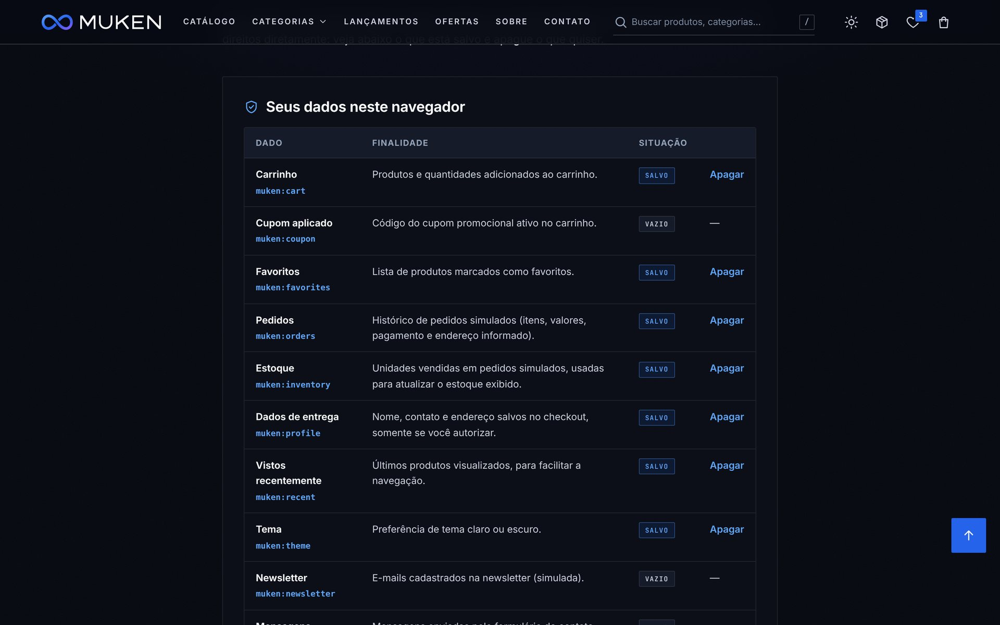 |

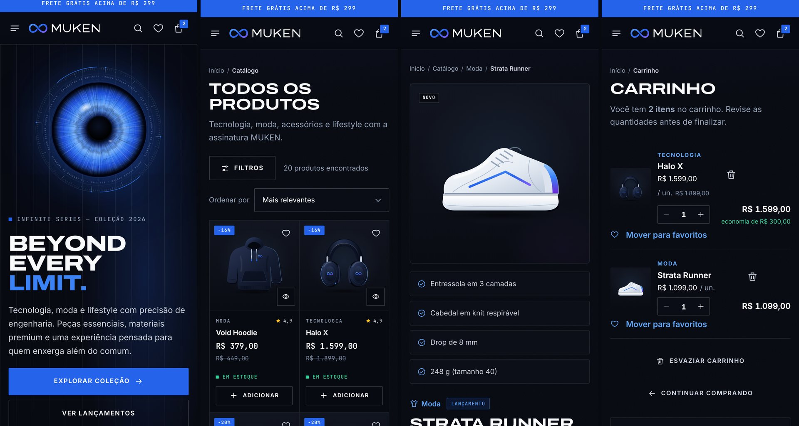

Todas as capturas estão em [`docs/screenshots/`](docs/screenshots).

## Estrutura de pastas

```text
muken-store/
├── index.html              # documento principal (SPA)
├── 404.html                # página 404 do GitHub Pages (autossuficiente)
├── site.webmanifest        # manifesto (ícones e cor do tema)
├── README.md
├── .gitignore
├── css/
│   ├── style.css           # tokens, temas, base, layout e páginas
│   ├── components.css      # botões, formulários, cards, modais, toasts...
│   └── responsive.css      # adaptações por tamanho de tela
├── js/
│   ├── utils.js            # formatação, escape de HTML, eventos
│   ├── storage.js          # camada segura sobre o LocalStorage
│   ├── products.js         # catálogo (dados) + consultas + estoque
│   ├── ui.js               # componentes, toasts, diálogos, animações
│   ├── filters.js          # pesquisa, filtros, ordenação, catálogo
│   ├── favorites.js        # favoritos
│   ├── cart.js             # carrinho, cupons, frete, totais
│   ├── orders.js           # histórico e status dos pedidos
│   ├── checkout.js         # checkout, validações, pagamentos simulados
│   ├── pages.js            # início, produto, sobre, contato, privacidade, 404
│   └── app.js              # roteador, tema, cabeçalho, inicialização
├── assets/
│   ├── images/             # ilustrações dos produtos e imagem de compartilhamento
│   ├── icons/              # favicons e ícones de aplicativo
│   ├── logo/               # logotipos (escuro, claro, símbolo)
│   └── fonts/              # Inter e Unbounded (woff2)
├── docs/
│   ├── relatorio.md        # relatório técnico acadêmico
│   ├── historico-prompts.md
│   └── screenshots/
└── tests/
    └── e2e.js              # testes ponta a ponta (opcional)
```

## Como executar localmente

Não há dependências nem etapa de build.

**Opção 1 — abrir direto:** baixe o projeto e dê dois cliques em `index.html`. (A busca automática de endereço pelo CEP fica desativada em `file://`; o restante funciona normalmente.)

**Opção 2 — servidor local (recomendado):**

```bash
git clone https://github.com/JpRibeiro011/muken-store.git
```

```bash
cd muken-store
```

```bash
python3 -m http.server 8000
```

Depois acesse `http://localhost:8000`. No VS Code, a extensão *Live Server* também funciona.

## Testes automatizados (opcional)

A pasta `tests/` contém uma suíte com **47 verificações ponta a ponta** (rotas, pesquisa, filtros, carrinho e cálculos, estoque, cupons, checkout, pedidos, favoritos, tema, persistência, sincronização entre abas, responsividade, acessibilidade com axe-core e erros de console). Ela não faz parte do site publicado.

```bash
npm install --no-save playwright axe-core
```

```bash
npx playwright install chromium
```

```bash
node tests/e2e.js
```

## Versionamento com Git

Comandos usados para versionar e publicar o projeto (o histórico de commits do repositório segue as etapas do desenvolvimento):

```bash
git init -b main
```

```bash
git add .
```

```bash
git commit -m "Initial project structure"
```

Commits seguintes: `Create MUKEN visual identity` · `Implement product catalog` · `Implement shopping cart` · `Add checkout functionality` · `Add favorites and LocalStorage` · `Improve responsive design` · `Create project documentation` · `Final adjustments and deployment`.

Criar o repositório remoto (pelo site do GitHub, como repositório **público e vazio**, ou pela GitHub CLI):

```bash
gh repo create JpRibeiro011/muken-store --public --description "MUKEN STORE — e-commerce conceitual"
```

Conectar o projeto local ao repositório e enviar os arquivos:

```bash
git remote add origin https://github.com/JpRibeiro011/muken-store.git
```

```bash
git push -u origin main
```

## Publicação no GitHub Pages

O site é 100% estático, usa apenas caminhos relativos e um roteador por hash (`#/catalogo`, `#/produto/...`), por isso funciona no GitHub Pages sem nenhuma configuração de servidor. Para publicar: **Settings → Pages → Build and deployment → Deploy from a branch → `main` / `(root)`**.

- 🌐 **Loja publicada:** https://jpribeiro011.github.io/muken-store/
- 📁 **Repositório:** https://github.com/JpRibeiro011/muken-store

## Informações acadêmicas

| | |
| --- | --- |
| **Aluno** | João Pedro Ribeiro |
| **Instituição** | *[preencher]* |
| **Curso / disciplina** | *[preencher]* |
| **Professor(a)** | *[preencher]* |
| **Metodologia** | Vibe Coding (desenvolvimento assistido por IA) |
| **Ano** | 2026 |

O processo de desenvolvimento está documentado no [relatório técnico](docs/relatorio.md) e no [histórico de prompts](docs/historico-prompts.md).

---

<div align="center">
<sub>MUKEN STORE é uma marca conceitual criada para fins acadêmicos, sem vínculo com <i>Jujutsu Kaisen</i> ou seus detentores. As fontes Inter e Unbounded são distribuídas sob a SIL Open Font License.</sub>
</div>
