# RELATÓRIO TÉCNICO — MUKEN STORE

> **Pendências do aluno antes da entrega** (itens marcados como **[preencher]** neste documento):
> - [ ] Dados da capa: instituição, curso, disciplina, professor(a), cidade e data.
> - [ ] Reflexão pessoal na Conclusão (seção 14).
> - [ ] Datas de acesso das referências (seção 15).
> - [ ] Confirmar os links públicos após a publicação no GitHub Pages (seções 9 e 12).

---

## 1. Capa

<div align="center">

**[NOME DA INSTITUIÇÃO DE ENSINO]** — [preencher]
**[CURSO]** — [preencher]
**[DISCIPLINA]** — [preencher]

<br>

**JOÃO PEDRO RIBEIRO**

<br>

# MUKEN STORE
### E-commerce conceitual desenvolvido com a metodologia Vibe Coding

*BEYOND EVERY LIMIT.*

<br>

Relatório técnico apresentado à disciplina **[preencher]**, sob orientação do(a) professor(a) **[preencher]**.

<br>

**[CIDADE]** — [preencher]
**2026**

</div>

---

## 2. Introdução

O comércio eletrônico se consolidou como um dos principais canais de venda do varejo, e a qualidade da experiência digital (identidade visual, clareza das informações, facilidade de compra e confiança) influencia diretamente a percepção de uma marca. Ao mesmo tempo, ferramentas de Inteligência Artificial passaram a participar ativamente do desenvolvimento de software, dando origem ao chamado **Vibe Coding**: uma forma de trabalho em que a pessoa desenvolvedora descreve, em linguagem natural, o que deseja construir e um agente de IA gera, executa e ajusta o código sob sua orientação.

Este relatório documenta o desenvolvimento da **MUKEN STORE**, uma loja virtual conceitual de tecnologia, moda, acessórios e lifestyle, construída exclusivamente com **HTML5, CSS3 e JavaScript Vanilla**, com persistência em **LocalStorage**, versionamento com **Git/GitHub** e hospedagem no **GitHub Pages**. O nome MUKEN faz referência ao conceito de infinito presente no universo de *Jujutsu Kaisen* (associado ao personagem Satoru Gojo). Essa inspiração foi traduzida em uma identidade visual original, sem o uso de personagens, logotipos ou artes da franquia.

O projeto foi conduzido com o agente de programação **Claude Code** (Anthropic), a partir de um prompt detalhado que foi decomposto em etapas de desenvolvimento, validação e correção. O registro desse processo está no Apêndice A e no arquivo [`historico-prompts.md`](historico-prompts.md).

## 3. Problema identificado

Projetos acadêmicos de e-commerce costumam se limitar a protótipos visuais: telas bonitas, mas sem regras de negócio reais (cálculos, estoque, validações) ou, no extremo oposto, sistemas funcionais com aparência de template genérico. Além disso, lojas estáticas enfrentam limitações práticas: não há servidor para guardar carrinho e pedidos, a publicação no GitHub Pages exige cuidado com caminhos e rotas, e funcionalidades como pagamento envolvem riscos de segurança e privacidade quando tratadas sem critério.

O problema abordado, portanto, foi: **como construir uma loja virtual estática, sem frameworks e sem backend, que tenha identidade de marca profissional e funcionalidades realmente operacionais (do catálogo ao pedido), de forma acessível, responsiva, segura para demonstração e documentada?**

## 4. Objetivo geral

Desenvolver e publicar um e-commerce conceitual funcional, a MUKEN STORE, com identidade visual premium e original, utilizando HTML5, CSS3, JavaScript Vanilla e LocalStorage, aplicando a metodologia Vibe Coding de forma produtiva e documentando todo o processo.

## 5. Objetivos específicos

1. Criar uma identidade visual original (logotipo, paleta, tipografia e direção de arte) inspirada nos conceitos de infinito, visão, vazio e energia.
2. Cadastrar um catálogo de produtos fictícios em arquivo JavaScript separado, com preço, promoção, estoque, avaliação e disponibilidade.
3. Implementar pesquisa e filtros que funcionem simultaneamente, além de diferentes ordenações.
4. Implementar um carrinho com cálculos automáticos, cupons, frete e bloqueio por estoque, persistido no LocalStorage.
5. Implementar um checkout demonstrativo com validação de campos e pagamentos simulados (PIX, cartão e boleto), sem solicitar dados financeiros reais.
6. Registrar e exibir o histórico de pedidos com status demonstrativo, além de favoritos e tema claro/escuro persistentes.
7. Garantir responsividade (do smartphone ao desktop) e acessibilidade (WCAG 2.1 AA, navegação por teclado, heurísticas de Nielsen).
8. Validar o sistema com testes automatizados e corrigir os problemas encontrados.
9. Versionar o projeto com commits organizados e publicá-lo no GitHub Pages.

## 6. Tecnologias utilizadas

| Tecnologia | Finalidade |
| --- | --- |
| **HTML5** | Estrutura semântica (`header`, `nav`, `main`, `footer`), formulários, elemento nativo `<dialog>` para modais e gavetas |
| **CSS3** | Variáveis (*design tokens*), temas claro/escuro, Grid e Flexbox, gradientes, animações, `@media`, `prefers-reduced-motion` |
| **JavaScript Vanilla (ES2020+)** | Roteador SPA, componentes de interface, regras de negócio, validações, eventos personalizados |
| **LocalStorage (Web Storage API)** | Persistência de carrinho, cupom, favoritos, pedidos, estoque vendido, tema, perfil, histórico de navegação e mensagens |
| **SVG** | Logotipo, sprite de ícones próprios e 20 ilustrações de produtos originais |
| **Intl API** | Formatação de moeda (R$) e datas no padrão brasileiro |
| **Git / GitHub** | Versionamento com commits por etapa e hospedagem do código |
| **GitHub Pages** | Hospedagem estática gratuita |
| **ViaCEP** (opcional) | Preenchimento do endereço a partir do CEP, com alternativa manual |
| **Playwright + axe-core** | Testes ponta a ponta e auditoria de acessibilidade (ferramentas de desenvolvimento, fora do site) |
| **Claude Code** | Agente de IA utilizado no Vibe Coding |

Não foram utilizados frameworks como React, Vue ou Angular, nem serviços pagos.

## 7. Desenvolvimento do sistema

### 7.1 Metodologia

O desenvolvimento seguiu o Vibe Coding em ciclos de **planejar → gerar → executar → validar → corrigir**. O prompt mestre foi decomposto pelo agente de IA em etapas que correspondem aos commits do repositório. Ao fim de cada etapa, a aplicação era aberta em um navegador automatizado (Chromium) para conferir o console, tirar capturas de tela, medir o layout e exercitar as funcionalidades. Os erros encontrados eram corrigidos antes de avançar.

| Etapa | Commit |
| --- | --- |
| Estrutura inicial | `Initial project structure` |
| Identidade visual (logotipo, tokens, cabeçalho, rodapé, hero) | `Create MUKEN visual identity` |
| Catálogo, pesquisa, filtros, produto, visualização rápida | `Implement product catalog` |
| Carrinho, cupons e frete | `Implement shopping cart` |
| Checkout, pagamentos simulados e pedidos | `Add checkout functionality` |
| Favoritos, LocalStorage, Sobre, Contato, Privacidade, 404 | `Add favorites and LocalStorage` |
| Responsividade e acessibilidade | `Improve responsive design` |
| Testes ponta a ponta e imagem de compartilhamento | `Add end-to-end tests and social preview image` |
| Documentação | `Create project documentation` |
| Ajustes finais e publicação | `Final adjustments and deployment` |

### 7.2 Arquitetura

A loja é uma **SPA (Single Page Application)** com um único `index.html`. O **roteador por hash** (`#/catalogo`, `#/produto/MK-TEC-001`, `#/checkout`…) interpreta a URL, escolhe a “view” correspondente, renderiza o HTML, liga os eventos (`mount`) e limpa recursos ao sair (`cleanup`). Essa escolha permite publicar no GitHub Pages sem configuração de servidor, já que as rotas nunca geram requisições para caminhos inexistentes, e mantém links compartilháveis, inclusive com filtros (`#/catalogo?cat=moda&promo=1`).

Os scripts são clássicos (`defer`) e organizados em módulos sob um namespace global `MK`, carregados em ordem de dependência. A escolha por scripts clássicos, e não por ES Modules, foi intencional: assim a loja **funciona também ao abrir o `index.html` diretamente do disco** (`file://`), cenário comum na correção de trabalhos acadêmicos.

```text
utils → storage → products → ui → filters → favorites → cart → orders → checkout → pages → app
```

A comunicação entre módulos usa um **barramento de eventos** (`cart:change`, `favorites:change`, `orders:change`, `route:change`), o que desacopla, por exemplo, o contador do cabeçalho da página do carrinho. Ações de interface usam **delegação de eventos** (`data-action="add-to-cart"`), de modo que qualquer card, em qualquer página, funciona sem código duplicado.

### 7.3 Dados e persistência

O catálogo (`products.js`) contém 20 produtos imutáveis (`Object.freeze`) com campos derivados: `available` (indicador de disponibilidade), avaliações fictícias e distribuição das notas. O **estoque exibido é dinâmico**: estoque cadastrado menos as unidades vendidas em pedidos simulados (`muken:inventory`).

A camada `storage.js` encapsula o LocalStorage com prefixo `muken:`, leitura JSON protegida contra dados corrompidos, **alternativa em memória** quando o armazenamento está indisponível e **sincronização entre abas** pelo evento nativo `storage`. Ao carregar o carrinho, os dados são saneados: produtos inexistentes são descartados e quantidades acima do estoque são ajustadas, com aviso à pessoa usuária.

### 7.4 Regras de negócio

- **Preço final:** preço promocional, quando existe; parcelamento em até 10x sem juros, com parcela mínima de R$ 30.
- **Carrinho:** soma pelo preço cheio (subtotal), descontos em produtos, cupom sobre o valor com promoções, frete padrão de R$ 24,90 (grátis a partir de R$ 299 ou com `FRETEZERO`) ou expresso de R$ 39,90, e desconto PIX de 5% sobre o valor após o cupom. Os valores monetários são arredondados em centavos para evitar erros de ponto flutuante.
- **Cupons:** `MUKEN10` (10%), `INFINITO15` (15% a partir de R$ 500), `BEYOND50` (R$ 50 a partir de R$ 350) e `FRETEZERO`. Se o valor mínimo deixa de ser atingido, o cupom fica pendente e a interface informa quanto falta.
- **Estoque:** nenhuma operação (adicionar, editar a quantidade, recomprar, confirmar o pedido) permite exceder o disponível.
- **Pedido:** número no formato `MK` + AAMMDD + código (ex.: `MK261105-7F3K`); os itens e valores são “fotografados” no momento da compra; o status evolui com o tempo (recebido → pagamento aprovado → em separação → enviado → entregue), com ritmos diferentes para cartão, PIX e boleto.

### 7.5 Segurança e privacidade

- **Nenhum dado real de cartão é solicitado:** o pagamento por cartão usa apenas cartões de teste selecionáveis, sem campos para número, validade ou código. Um deles simula recusa, para demonstrar o tratamento de erro.
- O **CPF** é validado pelos dígitos verificadores e armazenado no pedido apenas **mascarado**; o perfil salvo (opcional, mediante autorização) nunca inclui o CPF.
- Todo texto vindo da pessoa usuária é **escapado** antes de ser inserido no HTML (prevenção de XSS).
- A Política de Privacidade, inspirada na LGPD, informa o que é salvo e permite **apagar cada dado ou todos** os dados da loja no navegador.
- As fontes são hospedadas no próprio site (sem requisições a terceiros); a única chamada externa é a consulta opcional de CEP.

### 7.6 Design, UX e acessibilidade

O sistema visual usa *design tokens* em variáveis CSS para os dois temas. O tema escuro é o padrão da marca e é aplicado antes da renderização, sem “piscar”. As heurísticas de Nielsen orientaram decisões concretas:

| Heurística | Aplicação |
| --- | --- |
| Visibilidade do status | Contadores animados, notificações, barra de frete grátis, estoque, etapas do checkout, status do pedido |
| Correspondência com o mundo real | Linguagem do varejo brasileiro, R$, CEP, PIX, boleto, parcelamento |
| Controle e liberdade | “Desfazer” ao remover itens e favoritos, voltar entre etapas, editar dados na revisão |
| Consistência e padrões | Componentes reutilizáveis, mesmo card em todas as vitrines |
| Prevenção de erros | Bloqueio por estoque, máscaras, confirmação antes de esvaziar ou apagar dados, envio único |
| Reconhecimento em vez de memorização | Vistos recentemente, perfil de entrega opcional, chips de filtros ativos |
| Flexibilidade e eficiência | Atalho `/` para busca, filtros na URL, “comprar novamente”, “adicionar todos ao carrinho” |
| Estética e minimalismo | Paleta restrita, hierarquia tipográfica clara, sem excesso de neon |
| Recuperação de erros | Mensagens específicas por campo, resumo de erros com links, recusa de pagamento explicada |
| Ajuda e documentação | FAQ, cupons de teste visíveis, avisos de ambiente simulado |

Na acessibilidade: landmarks, link para pular o conteúdo, rótulos e `aria-describedby` nos formulários, `aria-invalid`, regiões `aria-live`, padrão *combobox* na busca, abas com setas e Home/End, foco preso e devolvido nos diálogos, foco no título a cada troca de página, contraste AA nos dois temas e respeito a `prefers-reduced-motion`.

### 7.7 Imagens dos produtos

Em vez de fotos de bancos de imagem, foram criadas **20 ilustrações vetoriais originais** (SVG gerado por código), em estilo de “render de estúdio” com fundo transparente. O palco (fundo com brilho) é aplicado via CSS e muda com o tema. Essa decisão garante originalidade e direitos de uso, coerência visual entre os produtos, arquivos leves (260 KB no total) e nitidez em qualquer resolução.

## 8. Estrutura de arquivos

```text
muken-store/
├── index.html, 404.html, site.webmanifest, README.md, .gitignore
├── css/      style.css · components.css · responsive.css
├── js/       utils · storage · products · ui · filters · favorites · cart · orders · checkout · pages · app
├── assets/   images/ (produtos, og-image) · icons/ (favicons) · logo/ · fonts/
├── docs/     relatorio.md · historico-prompts.md · screenshots/
└── tests/    e2e.js
```

| Arquivo | Responsabilidade | Linhas |
| --- | --- | ---: |
| `js/utils.js` | Formatação (moeda, datas), escape de HTML, normalização de texto, eventos | 176 |
| `js/storage.js` | Camada segura sobre o LocalStorage | 141 |
| `js/products.js` | Catálogo (dados), consultas, preços e estoque | 964 |
| `js/ui.js` | Card de produto, avaliações, preço, toasts, diálogos, animações | 440 |
| `js/filters.js` | Pesquisa, filtros simultâneos, ordenação, página do catálogo, sugestões | 678 |
| `js/favorites.js` | Favoritos e página de favoritos | 245 |
| `js/cart.js` | Carrinho, cupons, frete, totais, gaveta e página | 730 |
| `js/orders.js` | Histórico de pedidos e status | 323 |
| `js/checkout.js` | Checkout, validações, pagamentos simulados, tela de sucesso | 1.095 |
| `js/pages.js` | Início, produto, visualização rápida, sobre, contato, privacidade, 404 | 1.372 |
| `js/app.js` | Tema, roteador, cabeçalho, atalhos, inicialização | 458 |
| `css/style.css` | Tokens, temas, base, layout e páginas | 4.248 |
| `css/components.css` | Componentes reutilizáveis | 2.404 |
| `css/responsive.css` | Adaptações por tamanho de tela | 927 |
| `tests/e2e.js` | Testes ponta a ponta (opcional) | 536 |

*Contagem de linhas medida com `wc -l`. Totais: 6.622 linhas de JavaScript e 7.579 linhas de CSS. O site completo (sem `docs/` e `tests/`) ocupa cerca de 1,4 MB.*

## 9. Funcionalidades desenvolvidas

| Requisito | Implementação | Onde |
| --- | --- | --- |
| Página inicial completa | Header, menu com categorias, busca, favoritos e carrinho com contadores, hero com slogan, destaques, categorias, lançamentos, mais vendidos, promoção e rodapé completo | `pages.js`, `index.html` |
| ≥ 16 produtos em 4 categorias | 20 produtos, 5 por categoria, com todos os campos exigidos | `products.js` |
| Pesquisa e filtros simultâneos | Busca sem acentos, categoria, faixa de preço, promoção, lançamentos, disponibilidade e 8 ordenações | `filters.js` |
| Detalhes do produto | Imagem ampliada com zoom, descrição, preço, desconto, avaliações, disponibilidade, quantidade, carrinho, favoritar | `pages.js` |
| Carrinho funcional | Adicionar, remover, aumentar, diminuir, totais, itens, estoque, LocalStorage, estados vazios | `cart.js` |
| Checkout demonstrativo | Campos e validações, resumo, valores, confirmação, número do pedido, tela de sucesso; PIX, cartão e boleto simulados | `checkout.js` |
| Favoritos | Adicionar, remover, consultar e persistir | `favorites.js` |
| Histórico de pedidos | Número, data, produtos, quantidades, total, pagamento e status | `orders.js` |
| Tema claro/escuro | Alternância persistida, escuro como padrão | `app.js`, `style.css` |
| Extras | Animações de entrada, parallax, notificações, skeleton, visualização rápida, relacionados, 404, Sobre, Contato, Privacidade, indicadores de estoque, cupons, voltar ao topo | diversos |

**Links do projeto:**
- Loja publicada: https://jpribeiro011.github.io/muken-store/ — *[confirmar após a publicação]*
- Repositório: https://github.com/JpRibeiro011/muken-store

## 10. Capturas de tela

**Figura 1 — Página inicial (tema escuro, padrão da marca)**
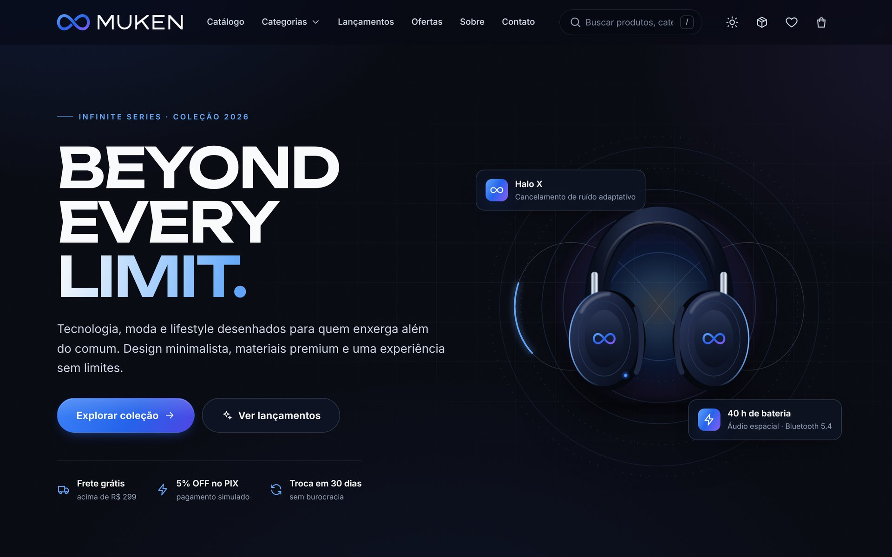

**Figura 2 — Página inicial no tema claro**
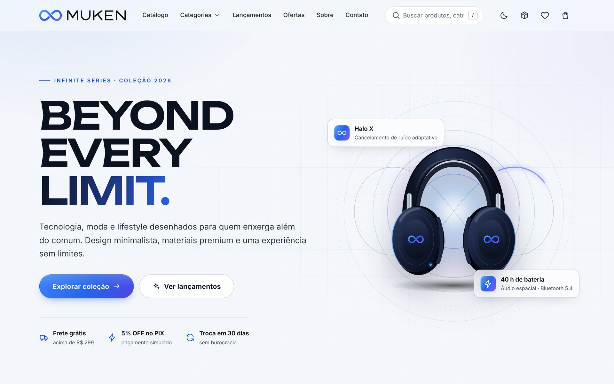

**Figura 3 — Categorias e destaques**
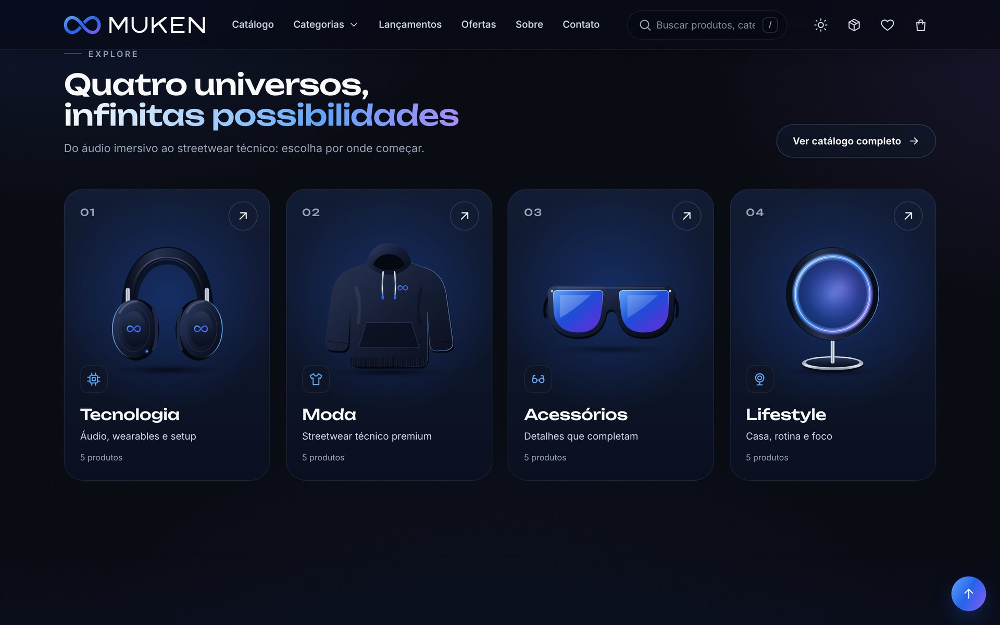

**Figura 4 — Catálogo com filtros simultâneos (Tecnologia + Acessórios + promoção, ordenado por menor preço)**
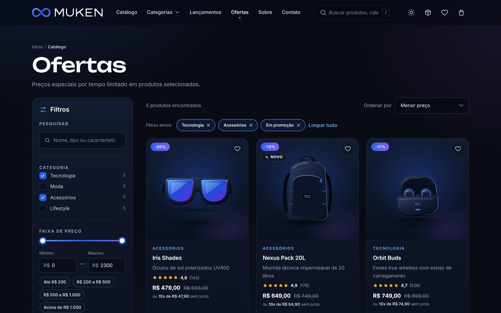

**Figura 5 — Página de detalhes do produto**
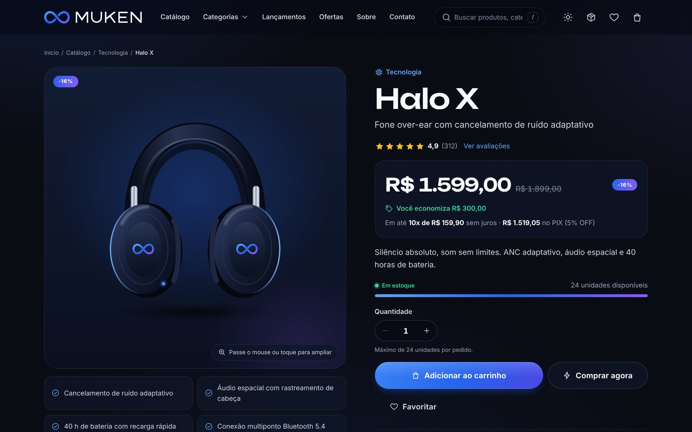

**Figura 6 — Visualização rápida em modal**
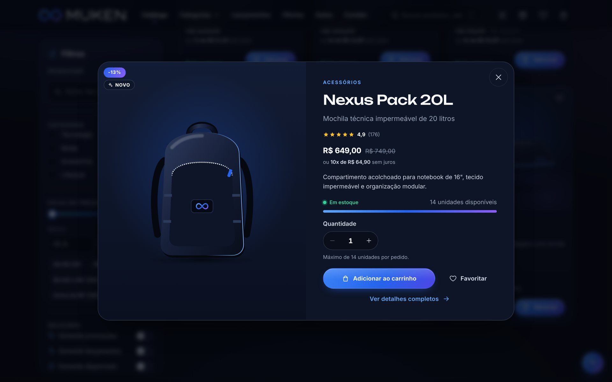

**Figura 7 — Carrinho com cupom INFINITO15 aplicado**
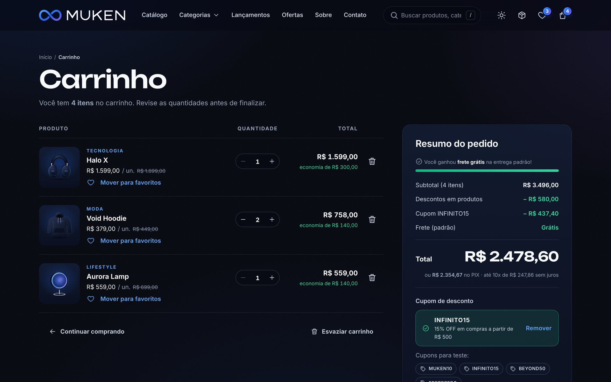

**Figura 8 — Mini carrinho (gaveta lateral)**


**Figura 9 — Checkout, etapa de pagamento com cartão de teste**
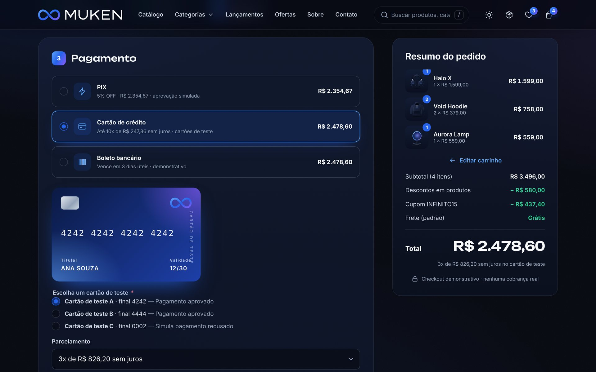

**Figura 10 — Pedido confirmado com PIX simulado**


**Figura 11 — Histórico de pedidos com detalhes e linha do tempo**
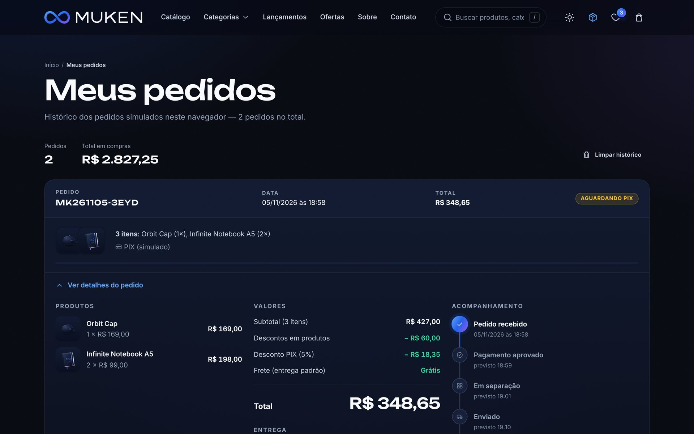

**Figura 12 — Favoritos**
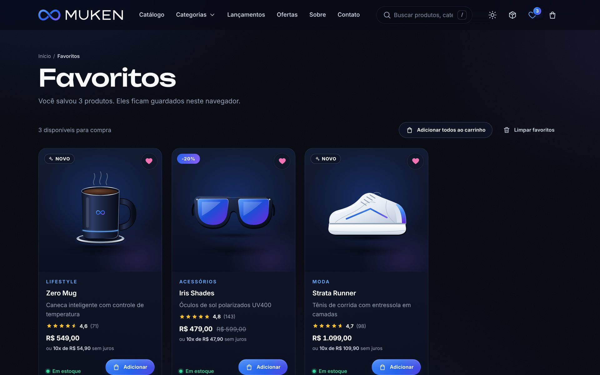

**Figura 13 — Identidade visual na página Sobre**
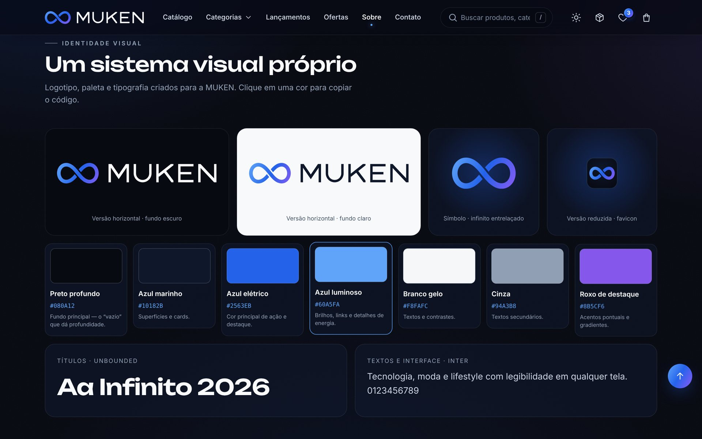

**Figura 14 — Política de Privacidade com gestão dos dados do navegador**
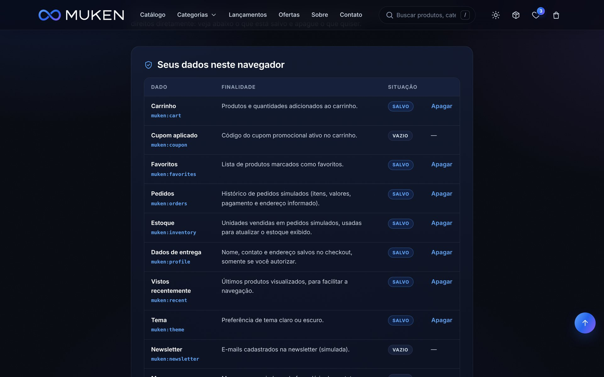

**Figura 15 — Página 404**
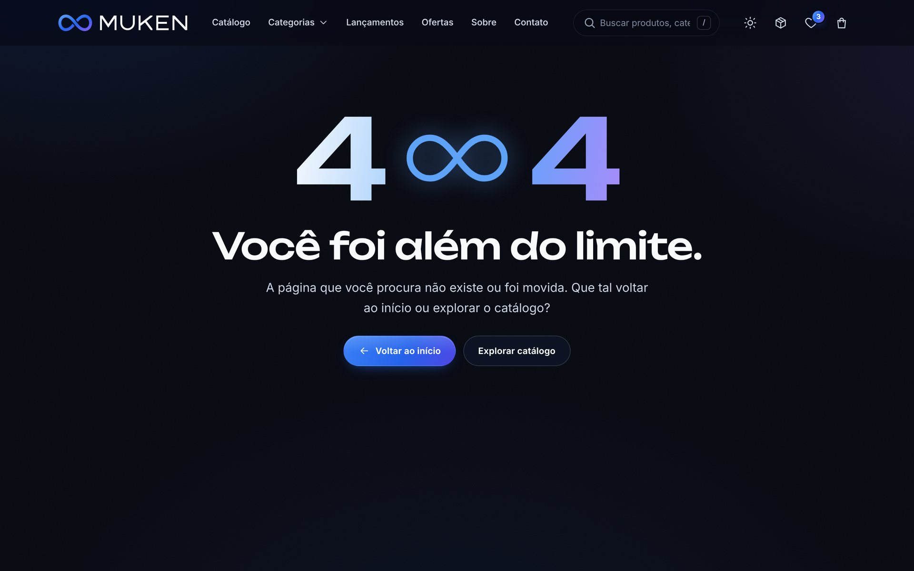

**Figura 16 — Versão para smartphone (início, catálogo, produto e carrinho)**
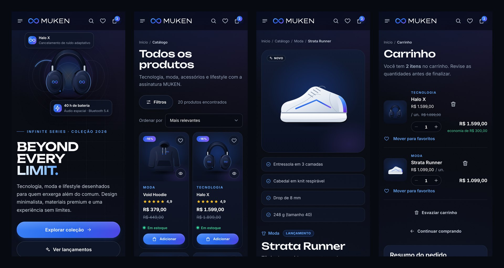

*Todas as capturas foram geradas a partir de fluxos reais da aplicação; os pedidos exibidos foram criados pelo próprio checkout.*

## 11. Dificuldades encontradas

As dificuldades abaixo ocorreram de fato durante o desenvolvimento e foram registradas no momento em que apareceram.

1. **Ambiente e publicação.** O ambiente remoto do agente de IA não tinha permissão para criar repositórios novos no GitHub (a criação foi recusada com HTTP 403). A solução é o aluno criar o repositório vazio `muken-store`, que então pode receber os commits. O mesmo ambiente bloqueava o acesso a algumas CDNs e à API ViaCEP: as fontes foram baixadas e hospedadas no projeto, e o preenchimento do endereço pelo CEP foi testado com respostas simuladas no navegador de testes.
2. **Ordem de carregamento dos scripts.** No primeiro teste, a página inicial não renderizou (`TypeError: Cannot set properties of undefined`), porque o registro de páginas era criado no último script e usado antes. Solução: inicializar os registros compartilhados no primeiro script carregado.
3. **Cascata do CSS.** Em quatro situações, regras genéricas de `components.css` (carregado depois) sobrescreveram estados específicos de `style.css`: botões exclusivos do celular apareceram no desktop, o resumo do carrinho foi deslocado cerca de 92 px porque o `position: sticky` foi anulado, e botões de rádio ficaram quadrados. A lição aprendida foi usar seletores contextuais para estados que dependem de layout.
4. **Estouros de layout em telas estreitas.** A auditoria automatizada de rolagem horizontal (320 a 1280 px) encontrou estouros em cinco páginas. A causa principal eram colunas `1fr`, cujo mínimo automático é o tamanho do conteúdo; um código PIX longo, por exemplo, alargava os grids. Solução: `minmax(0, 1fr)`, `min-width: 0` e `contain: inline-size`.
5. **Componentes de texto.** Um aviso com `display: flex` quebrava frases com trechos em negrito em várias colunas, e a legenda (`<legend>`) do formulário ficava sobre a borda, por comportamento nativo do navegador.
6. **Acessibilidade.** O axe-core apontou um `<p>` dentro de uma lista de definição (`<dl>`) no resumo de valores, uma estrutura inválida para leitores de tela. O texto foi movido para fora da lista.
7. **Testes automatizados.** Na primeira execução da suíte, houve falhas do próprio teste: a moeda formatada pelo `Intl` usa espaço não separável; o leitor de valores capturou o “4” de “(4 itens)”; navegar para a mesma rota não dispara a troca de página. Depois de corrigidos, os testes revelaram uma melhoria real: o checkout vazio não percebia itens adicionados em outra aba.
8. **Revisão visual.** Algumas falhas só apareceram nas capturas de tela: duas ilustrações pouco legíveis (os fones pareciam câmeras) foram redesenhadas, e a visualização rápida tinha a imagem invadindo a coluna de texto em telas largas (combinação de `aspect-ratio` com `min-height`).
9. **Interrupção da sessão.** O desenvolvimento foi interrompido uma vez por um sinal de interrupção da sessão; o agente explicou o ocorrido e retomou do ponto em que havia parado (Apêndice A, registro 12).

*[preencher, opcional] Dificuldades percebidas pelo aluno ao conduzir o processo (ex.: formular prompts, revisar o código gerado, entender a arquitetura).*

## 12. Resultados obtidos

| Indicador | Resultado verificado |
| --- | --- |
| Produtos cadastrados | 20 (5 por categoria), todos com os campos exigidos |
| Testes ponta a ponta (`tests/e2e.js`) | **47 de 47 aprovados** |
| Acessibilidade (axe-core, WCAG 2.1 A/AA) | **0 violações** em 13 rotas × 2 temas, e também com modal, gaveta e menu abertos |
| Contraste | Nenhuma violação de contraste nos temas claro e escuro |
| Responsividade | Sem rolagem horizontal em 320, 375, 414, 768, 1024 e 1280 px |
| Erros de console | Nenhum durante os testes (http e `file://`) |
| Cálculos conferidos | Ex.: 2 × R$ 989 + R$ 169 − 10% + frete expresso = **R$ 1.972,20**; PIX: 2 × R$ 219 − 5% = **R$ 416,10** |
| Funcionamento sem servidor | Verificado abrindo o `index.html` via `file://` |
| Peso do site | ≈ 1,4 MB (fontes, ícones, 20 ilustrações e imagem de compartilhamento) |
| Versionamento | Commits organizados por etapa, seguindo a sugestão do enunciado |
| Publicação | GitHub Pages — *[preencher/confirmar o link após a publicação]* |

O resultado é uma loja que se comporta como um e-commerce real dentro dos limites de um site estático: o estado sobrevive ao fechamento do navegador, os valores são consistentes em todas as telas, o estoque é respeitado de ponta a ponta e as decisões de segurança impedem o uso indevido de dados reais.

## 13. Melhorias futuras

- **Backend e banco de dados** (ex.: API REST com autenticação) para pedidos, estoque e contas compartilhados entre dispositivos.
- **Gateway de pagamento real** em ambiente de *sandbox* (PIX dinâmico, cartão tokenizado), seguindo o PCI DSS.
- **Painel administrativo** para cadastrar produtos, estoque, cupons e pedidos.
- **Variações de produto** (tamanho e cor) com estoque por variação.
- **Avaliações reais** enviadas pelas pessoas compradoras, com moderação.
- **PWA completo** com *service worker* para uso offline e notificações de status do pedido.
- **Internacionalização** (inglês e espanhol) e outras moedas.
- **Fotografia de produto** (ou renders 3D) para complementar as ilustrações vetoriais.
- **Integração contínua**: rodar `tests/e2e.js` automaticamente a cada *push* (GitHub Actions).

## 14. Conclusão

O projeto atingiu o objetivo de construir um e-commerce conceitual funcional, com identidade visual própria e aparência profissional, usando apenas HTML5, CSS3, JavaScript Vanilla e LocalStorage. As funcionalidades exigidas (catálogo, pesquisa, filtros simultâneos, carrinho com cálculos e estoque, checkout com pagamentos simulados, favoritos, histórico de pedidos e tema) foram implementadas e verificadas por testes automatizados, auditoria de acessibilidade e revisão visual.

Do ponto de vista do Vibe Coding, a experiência mostrou que a IA acelera muito a produção de código e de artefatos (ilustrações, documentação, testes), mas que **a qualidade depende do ciclo de validação**: vários problemas só apareceram ao executar a aplicação, medir o layout, auditar a acessibilidade e observar as capturas de tela. Especificar com clareza o que se quer, como foi feito no prompt mestre, e exigir verificação a cada etapa foram fatores decisivos para o resultado.

*[preencher] Reflexão pessoal do aluno: o que aprendeu sobre as tecnologias, sobre o uso de IA no desenvolvimento, quais decisões tomaria de forma diferente e como avalia o resultado.*

## 15. Referências

> As datas de acesso devem ser preenchidas pelo aluno ao consultar cada fonte.

ANTHROPIC. **Claude Code**: documentação. Disponível em: https://code.claude.com/docs. Acesso em: [preencher].

BRASIL. **Lei nº 13.709, de 14 de agosto de 2018**. Lei Geral de Proteção de Dados Pessoais (LGPD). Brasília, DF: Presidência da República, 2018. Disponível em: https://www.planalto.gov.br/ccivil_03/_ato2015-2018/2018/lei/l13709.htm. Acesso em: [preencher].

DEQUE SYSTEMS. **axe-core**: accessibility engine for automated web UI testing. Disponível em: https://github.com/dequelabs/axe-core. Acesso em: [preencher].

GITHUB. **GitHub Pages documentation**. Disponível em: https://docs.github.com/pt/pages. Acesso em: [preencher].

GOOGLE FONTS. **Inter** e **Unbounded**. Licença SIL Open Font License 1.1. Disponível em: https://fonts.google.com. Acesso em: [preencher].

KARPATHY, Andrej. [Publicação em que cunha o termo “vibe coding”]. **X (antigo Twitter)**, 2 fev. 2025.

MICROSOFT. **Playwright**: documentation. Disponível em: https://playwright.dev. Acesso em: [preencher].

MOZILLA. **MDN Web Docs**: Window.localStorage; elemento `<dialog>`; Intl.NumberFormat; CSS Grid Layout. Disponível em: https://developer.mozilla.org/pt-BR/. Acesso em: [preencher].

NIELSEN, Jakob. **10 Usability Heuristics for User Interface Design**. Nielsen Norman Group, 1994 (atualizado). Disponível em: https://www.nngroup.com/articles/ten-usability-heuristics/. Acesso em: [preencher].

VIACEP. **Webservice gratuito de consulta de CEP**. Disponível em: https://viacep.com.br. Acesso em: [preencher].

W3C. **Web Content Accessibility Guidelines (WCAG) 2.1**. W3C Recommendation. Disponível em: https://www.w3.org/TR/WCAG21/. Acesso em: [preencher].

W3C. **ARIA Authoring Practices Guide (APG)**. Disponível em: https://www.w3.org/WAI/ARIA/apg/. Acesso em: [preencher].

## 16. Apêndice A — Histórico de Prompts

O histórico completo, com objetivo, prompt, resumo da resposta da IA, aplicação prática e adaptações de cada etapa, além do prompt mestre na íntegra, está em [`historico-prompts.md`](historico-prompts.md). Resumo:

| # | Tema do prompt | Principais entregas |
| --- | --- | --- |
| 1 | Estrutura inicial | Pastas, arquivos base, Git, arquitetura SPA por hash |
| 2 | Identidade visual | Símbolo do infinito entrelaçado, logotipo próprio, favicon, tokens, hero |
| 3 | Catálogo | 20 produtos, home completa, página do produto, visualização rápida, skeleton |
| 4 | Pesquisa | Busca sem acentos, sugestões acessíveis, atalho `/` |
| 5 | Filtros | Filtros simultâneos, faixa de preço, 8 ordenações, estado na URL |
| 6 | Carrinho | Cálculos, cupons, frete, estoque, desfazer, sincronização entre abas |
| 7 | Checkout | 3 etapas, validação de CPF, PIX/cartão/boleto simulados, pedidos |
| 8 | LocalStorage | Camada segura, favoritos, tema, privacidade com exclusão de dados |
| 9 | Responsividade | Auditoria 320–1280 px, gavetas, axe-core sem violações |
| 10 | Testes e UX | Suíte com 47 testes, correções e melhorias |
| 11 | Documentação e publicação | README, relatório, histórico, capturas |
| 12 | “por que parou?” | Explicação da interrupção e retomada |
