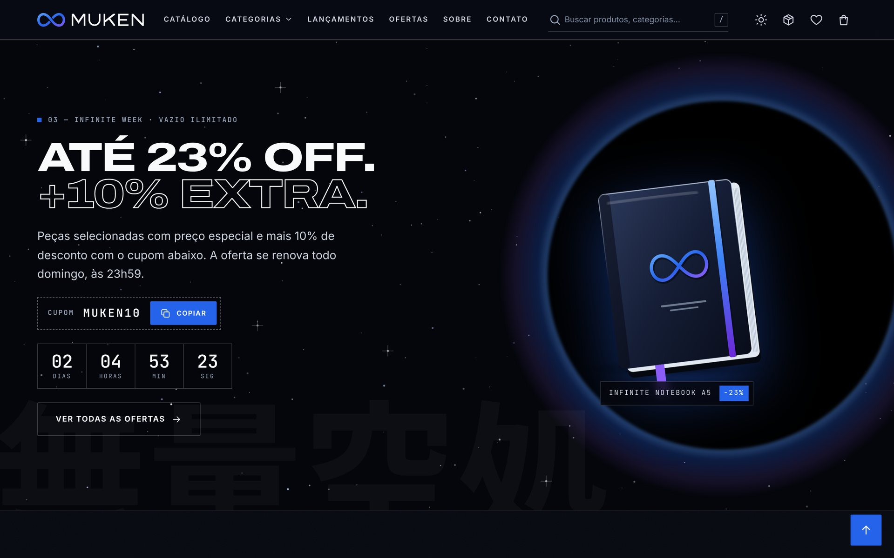

# RELATÓRIO TÉCNICO — MUKEN STORE

## 1. Capa

<div align="center">

**CENTRO UNIVERSITÁRIO DE BRASÍLIA — CEUB**<br>
**ENGENHARIA DE SOFTWARE**<br>
Desenvolvimento de Interfaces — Turma B (0726) · Asa Norte · Noturno

<br>

**JOÃO PEDRO RIBEIRO**

<br>

# MUKEN STORE
### E-commerce conceitual desenvolvido com a metodologia Vibe Coding

*BEYOND EVERY LIMIT.*

<br>

Relatório técnico apresentado à disciplina **Desenvolvimento de Interfaces**, do curso de Engenharia de Software do Centro Universitário de Brasília (CEUB).<br>
Docente: **Adriana**

<br>

**BRASÍLIA — DF**<br>
**2026**<br>
Data de entrega: 25 de novembro de 2026

</div>

---

## 2. Introdução

O comércio eletrônico se consolidou como um dos principais canais de venda do varejo, e a qualidade da experiência digital (identidade visual, clareza das informações, facilidade de compra e confiança) influencia diretamente a percepção de uma marca. Ao mesmo tempo, ferramentas de Inteligência Artificial passaram a participar ativamente do desenvolvimento de software, dando origem ao chamado **Vibe Coding**: uma forma de trabalho em que a pessoa desenvolvedora descreve, em linguagem natural, o que deseja construir e um agente de IA gera, executa e ajusta o código sob sua orientação.

Este relatório documenta o desenvolvimento da **MUKEN STORE**, uma loja virtual conceitual de tecnologia, moda, acessórios e lifestyle, construída exclusivamente com **HTML5, CSS3 e JavaScript Vanilla**, com persistência em **LocalStorage**, versionamento com **Git/GitHub** e hospedagem no **GitHub Pages**. O nome MUKEN faz referência ao conceito de infinito presente no universo de *Jujutsu Kaisen* (associado ao personagem Satoru Gojo). Essa inspiração foi traduzida em uma identidade visual original, sem o uso de personagens, logotipos ou artes da franquia.

O projeto foi conduzido com o agente de programação **Claude Code** (Anthropic), a partir de um prompt detalhado que foi decomposto em etapas de desenvolvimento, validação e correção. Depois da primeira publicação, a interface passou por um redesign completo, motivado por uma avaliação crítica feita durante o projeto: o visual da primeira versão foi considerado genérico demais (seção 7.6). O registro de todo o processo está no Apêndice A e no arquivo [`historico-prompts.md`](historico-prompts.md).

## 3. Problema identificado

Projetos acadêmicos de e-commerce costumam se limitar a protótipos visuais: telas bonitas, mas sem regras de negócio reais (cálculos, estoque, validações) ou, no extremo oposto, sistemas funcionais com aparência de template genérico. Além disso, lojas estáticas enfrentam limitações práticas: não há servidor para guardar carrinho e pedidos, a publicação no GitHub Pages exige cuidado com caminhos e rotas, e funcionalidades como pagamento envolvem riscos de segurança e privacidade quando tratadas sem critério.

O problema abordado, portanto, foi: **como construir uma loja virtual estática, sem frameworks e sem backend, que tenha identidade de marca profissional e funcionalidades realmente operacionais (do catálogo ao pedido), de forma acessível, responsiva, segura para demonstração e documentada?**

## 4. Objetivo geral

Desenvolver e publicar um e-commerce conceitual funcional, a MUKEN STORE, com identidade visual premium e original, utilizando HTML5, CSS3, JavaScript Vanilla e LocalStorage, aplicando a metodologia Vibe Coding de forma produtiva e documentando todo o processo.

## 5. Objetivos específicos

1. Criar uma identidade visual original (logotipo, paleta, tipografia e direção de arte) inspirada nos conceitos de infinito, visão, vazio e energia.
2. Cadastrar um catálogo de produtos fictícios em arquivo JavaScript separado, com preço, promoção, estoque, avaliação e disponibilidade.
3. Implementar pesquisa e filtros que funcionem simultaneamente, além de diferentes ordenações.
4. Implementar um carrinho com cálculos automáticos, cupons, frete e bloqueio por estoque, persistido no LocalStorage.
5. Implementar um checkout demonstrativo com validação de campos e pagamentos simulados (PIX, cartão e boleto), sem solicitar dados financeiros reais.
6. Registrar e exibir o histórico de pedidos com status demonstrativo, além de favoritos e tema claro/escuro persistentes.
7. Garantir responsividade (do smartphone ao desktop) e acessibilidade (WCAG 2.1 AA, navegação por teclado, heurísticas de Nielsen).
8. Validar o sistema com testes automatizados e corrigir os problemas encontrados.
9. Versionar o projeto com commits organizados e publicá-lo no GitHub Pages.

## 6. Tecnologias utilizadas

| Tecnologia | Finalidade |
| --- | --- |
| **HTML5** | Estrutura semântica (`header`, `nav`, `main`, `footer`), formulários, elemento nativo `<dialog>` para modais e gavetas |
| **CSS3** | Variáveis (*design tokens*), temas claro/escuro, Grid e Flexbox, gradientes, animações, `@media`, `prefers-reduced-motion` |
| **JavaScript Vanilla (ES2020+)** | Roteador SPA, componentes de interface, regras de negócio, validações, eventos personalizados |
| **LocalStorage (Web Storage API)** | Persistência de carrinho, cupom, favoritos, pedidos, estoque vendido, tema, perfil, histórico de navegação e mensagens |
| **SVG** | Logotipo, sprite de ícones próprios, 20 ilustrações de produtos, a íris do hero e o campo de estrelas, todos originais e gerados por código |
| **Fontes livres (SIL OFL)** | Archivo Expanded (títulos), Inter (textos), JetBrains Mono (rótulos técnicos e preços) e Noto Sans JP (subconjunto de 22 caracteres japoneses usados como elementos gráficos), hospedadas no próprio projeto |
| **Intl API** | Formatação de moeda (R$) e datas no padrão brasileiro |
| **Git / GitHub** | Versionamento com commits por etapa e hospedagem do código |
| **GitHub Pages** | Hospedagem estática gratuita |
| **ViaCEP** (opcional) | Preenchimento do endereço a partir do CEP, com alternativa manual |
| **Playwright + axe-core** | Testes ponta a ponta e auditoria de acessibilidade (ferramentas de desenvolvimento, fora do site) |
| **Claude Code** | Agente de IA utilizado no Vibe Coding |

Não foram utilizados frameworks como React, Vue ou Angular, nem serviços pagos.

## 7. Desenvolvimento do sistema

### 7.1 Metodologia

O desenvolvimento seguiu o Vibe Coding em ciclos de **planejar → gerar → executar → validar → corrigir**. O prompt mestre foi decomposto pelo agente de IA em etapas que correspondem aos commits do repositório. Ao fim de cada etapa, a aplicação era aberta em um navegador automatizado (Chromium) para conferir o console, tirar capturas de tela, medir o layout e exercitar as funcionalidades. Os erros encontrados eram corrigidos antes de avançar. Depois da publicação, um novo ciclo foi aberto a partir de uma crítica de design (“achei ele muito genérico”), descrito na seção 7.6.

| Etapa | Commit |
| --- | --- |
| Estrutura inicial | `Initial project structure` |
| Identidade visual (logotipo, tokens, cabeçalho, rodapé, hero) | `Create MUKEN visual identity` |
| Catálogo, pesquisa, filtros, produto, visualização rápida | `Implement product catalog` |
| Carrinho, cupons e frete | `Implement shopping cart` |
| Checkout, pagamentos simulados e pedidos | `Add checkout functionality` |
| Favoritos, LocalStorage, Sobre, Contato, Privacidade, 404 | `Add favorites and LocalStorage` |
| Responsividade e acessibilidade | `Improve responsive design` |
| Testes ponta a ponta e imagem de compartilhamento | `Add end-to-end tests and social preview image` |
| Documentação | `Create project documentation` |
| Ajustes finais e publicação | `Final adjustments and deployment` |
| Registro da publicação no GitHub Pages | `Update documentation after deployment` |
| Redesign da interface (hero “Seis Olhos”, grade editorial, nova tipografia) | `Redesign interface with Six Eyes hero and editorial grid` |
| Correção encontrada na verificação do site no ar | `Fix header search width on notebook screens` |
| Relatório preenchido e documentação do redesign | `Update documentation after redesign` |

### 7.2 Arquitetura

A loja é uma **SPA (Single Page Application)** com um único `index.html`. O **roteador por hash** (`#/catalogo`, `#/produto/MK-TEC-001`, `#/checkout`…) interpreta a URL, escolhe a “view” correspondente, renderiza o HTML, liga os eventos (`mount`) e limpa recursos ao sair (`cleanup`). Essa escolha permite publicar no GitHub Pages sem configuração de servidor, já que as rotas nunca geram requisições para caminhos inexistentes, e mantém links compartilháveis, inclusive com filtros (`#/catalogo?cat=moda&promo=1`).

Os scripts são clássicos (`defer`) e organizados em módulos sob um namespace global `MK`, carregados em ordem de dependência. A escolha por scripts clássicos, e não por ES Modules, foi intencional: assim a loja **funciona também ao abrir o `index.html` diretamente do disco** (`file://`), cenário comum na correção de trabalhos acadêmicos.

```text
utils → storage → products → ui → filters → favorites → cart → orders → checkout → pages → app
```

A comunicação entre módulos usa um **barramento de eventos** (`cart:change`, `favorites:change`, `orders:change`, `route:change`), o que desacopla, por exemplo, o contador do cabeçalho da página do carrinho. Ações de interface usam **delegação de eventos** (`data-action="add-to-cart"`), de modo que qualquer card, em qualquer página, funciona sem código duplicado.

### 7.3 Dados e persistência

O catálogo (`products.js`) contém 20 produtos imutáveis (`Object.freeze`) com campos derivados: `available` (indicador de disponibilidade), avaliações fictícias e distribuição das notas. O **estoque exibido é dinâmico**: estoque cadastrado menos as unidades vendidas em pedidos simulados (`muken:inventory`).

A camada `storage.js` encapsula o LocalStorage com prefixo `muken:`, leitura JSON protegida contra dados corrompidos, **alternativa em memória** quando o armazenamento está indisponível e **sincronização entre abas** pelo evento nativo `storage`. Ao carregar o carrinho, os dados são saneados: produtos inexistentes são descartados e quantidades acima do estoque são ajustadas, com aviso à pessoa usuária.

### 7.4 Regras de negócio

- **Preço final:** preço promocional, quando existe; parcelamento em até 10x sem juros, com parcela mínima de R$ 30.
- **Carrinho:** soma pelo preço cheio (subtotal), descontos em produtos, cupom sobre o valor com promoções, frete padrão de R$ 24,90 (grátis a partir de R$ 299 ou com `FRETEZERO`) ou expresso de R$ 39,90, e desconto PIX de 5% sobre o valor após o cupom. Os valores monetários são arredondados em centavos para evitar erros de ponto flutuante.
- **Cupons:** `MUKEN10` (10%), `INFINITO15` (15% a partir de R$ 500), `BEYOND50` (R$ 50 a partir de R$ 350) e `FRETEZERO`. Se o valor mínimo deixa de ser atingido, o cupom fica pendente e a interface informa quanto falta.
- **Estoque:** nenhuma operação (adicionar, editar a quantidade, recomprar, confirmar o pedido) permite exceder o disponível.
- **Pedido:** número no formato `MK` + AAMMDD + código (ex.: `MK261105-7F3K`); os itens e valores são “fotografados” no momento da compra; o status evolui com o tempo (recebido → pagamento aprovado → em separação → enviado → entregue), com ritmos diferentes para cartão, PIX e boleto.

### 7.5 Segurança e privacidade

- **Nenhum dado real de cartão é solicitado:** o pagamento por cartão usa apenas cartões de teste selecionáveis, sem campos para número, validade ou código. Um deles simula recusa, para demonstrar o tratamento de erro.
- O **CPF** é validado pelos dígitos verificadores e armazenado no pedido apenas **mascarado**; o perfil salvo (opcional, mediante autorização) nunca inclui o CPF.
- Todo texto vindo da pessoa usuária é **escapado** antes de ser inserido no HTML (prevenção de XSS).
- A Política de Privacidade, inspirada na LGPD, informa o que é salvo e permite **apagar cada dado ou todos** os dados da loja no navegador.
- As fontes são hospedadas no próprio site (sem requisições a terceiros); a única chamada externa é a consulta opcional de CEP.

### 7.6 Design, UX e acessibilidade

**Primeira versão e crítica.** A primeira versão publicada seguia uma estética “futurista” comum: cantos bem arredondados, botões em formato de pílula, degradês e brilhos em quase todos os elementos, a fonte Unbounded nos títulos e um hero com o produto sobre anéis concêntricos. Tudo funcionava, mas, olhando com calma depois da publicação, o visual foi considerado **genérico demais**, com cara de template. O pedido foi deixá-lo mais profissional mantendo a referência ao Satoru Gojo (Apêndice A, registro 15).

**Nova direção de arte.** O redesign adotou uma linguagem de **luxo técnico com minimalismo editorial japonês**:

- **Tipografia como estrutura:** títulos em Archivo expandida, em caixa alta e com entrelinha curta; rótulos, preços, códigos de produto (ex.: `MK-TEC-001`) e etiquetas técnicas em JetBrains Mono; textos de leitura em Inter.
- **Grade editorial:** cantos retos (raio de 2 px), grades de linhas finas de 1 px nas vitrines e categorias, seções numeradas (01 a 06) com rótulo técnico e linha fina no topo, e linhas verticais de 12 colunas no hero.
- **Cor com parcimônia:** o azul elétrico passou a marcar só ação e destaque (botões, índices, a palavra “LIMIT.”), e os degradês saíram da interface.
- **Acabamento:** barra de avisos no topo, faixa infinita em rolagem contínua, cards de produto com barra de “visualização rápida” que sobe ao passar o mouse e o logotipo em escala monumental no rodapé.

**A referência ao Gojo, só em conceitos.** Cada ideia ligada ao personagem virou um recurso visual original, sem personagens, logotipos ou artes oficiais:

| Conceito | Tradução no site |
| --- | --- |
| **Seis Olhos (六眼)** | Hero com uma íris azul ilustrada por código (SVG procedural), cercada por um anel técnico com graduação em graus e texto em órbita. A pupila acompanha o cursor e, quando o mouse para, faz pequenos movimentos sacádicos. |
| **Infinito (無限)** | Símbolo da marca, faixa de rolagem infinita, separadores 無限 e marca-d'água tipográfica no manifesto e na página Sobre. |
| **Vazio Ilimitado (無量空処)** | Promoção da semana dentro de um “vazio”: campo de estrelas em movimento lento e um horizonte escuro com halo azul e violeta atrás do produto. |
| **Azul (蒼)** | O azul elétrico como única cor de destaque; o caractere também marca o pilar “Energia” do manifesto. |

Os caracteres japoneses funcionam como elementos gráficos, com `lang="ja"`, e a fonte foi reduzida a um subconjunto só com os caracteres usados (cerca de 11 KB). O slogan ganhou uma versão em japonês, **すべての限界を超えて** (“além de todos os limites”). O olho é decorativo (`aria-hidden`), fica parado com `prefers-reduced-motion`, pausa quando sai da tela (IntersectionObserver) e só segue o cursor em dispositivos com mouse. O hero continua escuro também no tema claro, por decisão de design: a íris luminosa depende do contraste com o fundo.

**Tokens e heurísticas.** O sistema visual usa *design tokens* em variáveis CSS para os dois temas. O tema escuro é o padrão da marca e é aplicado antes da renderização, sem “piscar”. As heurísticas de Nielsen orientaram decisões concretas:

| Heurística | Aplicação |
| --- | --- |
| Visibilidade do status | Contadores animados, notificações, barra de frete grátis, estoque, etapas do checkout, status do pedido |
| Correspondência com o mundo real | Linguagem do varejo brasileiro, R$, CEP, PIX, boleto, parcelamento |
| Controle e liberdade | “Desfazer” ao remover itens e favoritos, voltar entre etapas, editar dados na revisão |
| Consistência e padrões | Componentes reutilizáveis, mesmo card em todas as vitrines |
| Prevenção de erros | Bloqueio por estoque, máscaras, confirmação antes de esvaziar ou apagar dados, envio único |
| Reconhecimento em vez de memorização | Vistos recentemente, perfil de entrega opcional, chips de filtros ativos |
| Flexibilidade e eficiência | Atalho `/` para busca, filtros na URL, “comprar novamente”, “adicionar todos ao carrinho” |
| Estética e minimalismo | Paleta restrita, cantos retos, grade de linhas finas, hierarquia tipográfica clara e azul reservado para ação e destaque |
| Recuperação de erros | Mensagens específicas por campo, resumo de erros com links, recusa de pagamento explicada |
| Ajuda e documentação | FAQ, cupons de teste visíveis, avisos de ambiente simulado |

Na acessibilidade: landmarks, link para pular o conteúdo, rótulos e `aria-describedby` nos formulários, `aria-invalid`, regiões `aria-live`, padrão *combobox* na busca, abas com setas e Home/End, foco preso e devolvido nos diálogos, foco no título a cada troca de página, contraste AA nos dois temas e respeito a `prefers-reduced-motion`.

### 7.7 Imagens dos produtos

Em vez de fotos de bancos de imagem, foram criadas **20 ilustrações vetoriais originais** (SVG gerado por código), em estilo de “render de estúdio” com fundo transparente. O palco (fundo com brilho) é aplicado via CSS e muda com o tema. Essa decisão garante originalidade e direitos de uso, coerência visual entre os produtos, arquivos leves (cerca de 230 KB no total) e nitidez em qualquer resolução. No redesign, o mesmo processo gerou a **íris do hero** (fibras radiais, criptas, sulcos de contração e o colarete serrilhado, em um SVG de 136 KB; os reflexos de luz são camadas de CSS) e o **campo de estrelas** do Vazio Ilimitado (19 KB).

## 8. Estrutura de arquivos

```text
muken-store/
├── index.html, 404.html, site.webmanifest, README.md, .gitignore
├── css/      style.css · components.css · responsive.css
├── js/       utils · storage · products · ui · filters · favorites · cart · orders · checkout · pages · app
├── assets/   images/ (produtos, íris, estrelas, og-image) · icons/ (favicons) · logo/ · fonts/
├── docs/     relatorio.md · historico-prompts.md · screenshots/
└── tests/    e2e.js
```

| Arquivo | Responsabilidade | Linhas |
| --- | --- | ---: |
| `js/utils.js` | Formatação (moeda, datas), escape de HTML, normalização de texto, eventos | 176 |
| `js/storage.js` | Camada segura sobre o LocalStorage | 141 |
| `js/products.js` | Catálogo (dados), consultas, preços e estoque | 964 |
| `js/ui.js` | Card de produto, avaliações, preço, toasts, diálogos, animações | 453 |
| `js/filters.js` | Pesquisa, filtros simultâneos, ordenação, página do catálogo, sugestões | 678 |
| `js/favorites.js` | Favoritos e página de favoritos | 245 |
| `js/cart.js` | Carrinho, cupons, frete, totais, gaveta e página | 730 |
| `js/orders.js` | Histórico de pedidos e status | 323 |
| `js/checkout.js` | Checkout, validações, pagamentos simulados, tela de sucesso | 1.095 |
| `js/pages.js` | Início (hero “Seis Olhos”), produto, visualização rápida, sobre, contato, privacidade, 404 | 1.467 |
| `js/app.js` | Tema, roteador, cabeçalho, atalhos, inicialização | 458 |
| `css/style.css` | Tokens, temas, base, layout e páginas | 4.534 |
| `css/components.css` | Componentes reutilizáveis | 2.439 |
| `css/responsive.css` | Adaptações por tamanho de tela | 936 |
| `tests/e2e.js` | Testes ponta a ponta (opcional) | 540 |

*Contagem de linhas medida com `wc -l` após o redesign. Totais: 6.730 linhas de JavaScript e 7.909 linhas de CSS. O site completo (sem `docs/` e `tests/`) ocupa cerca de 1,7 MB; desse total, 446 KB são da imagem de compartilhamento, que só é baixada por redes sociais e aplicativos de mensagem, não por quem visita a loja.*

## 9. Funcionalidades desenvolvidas

| Requisito | Implementação | Onde |
| --- | --- | --- |
| Página inicial completa | Barra de avisos, header, menu com categorias, busca, favoritos e carrinho com contadores, hero “Seis Olhos” com o slogan, faixa infinita, categorias, destaques, promoção “Vazio Ilimitado” com contagem regressiva, lançamentos, mais vendidos, manifesto e rodapé completo | `pages.js`, `index.html` |
| ≥ 16 produtos em 4 categorias | 20 produtos, 5 por categoria, com todos os campos exigidos | `products.js` |
| Pesquisa e filtros simultâneos | Busca sem acentos, categoria, faixa de preço, promoção, lançamentos, disponibilidade e 8 ordenações | `filters.js` |
| Detalhes do produto | Imagem ampliada com zoom, descrição, preço, desconto, avaliações, disponibilidade, quantidade, carrinho, favoritar | `pages.js` |
| Carrinho funcional | Adicionar, remover, aumentar, diminuir, totais, itens, estoque, LocalStorage, estados vazios | `cart.js` |
| Checkout demonstrativo | Campos e validações, resumo, valores, confirmação, número do pedido, tela de sucesso; PIX, cartão e boleto simulados | `checkout.js` |
| Favoritos | Adicionar, remover, consultar e persistir | `favorites.js` |
| Histórico de pedidos | Número, data, produtos, quantidades, total, pagamento e status | `orders.js` |
| Tema claro/escuro | Alternância persistida, escuro como padrão | `app.js`, `style.css` |
| Extras | Animações de entrada, olho interativo no hero, notificações, skeleton, visualização rápida, relacionados, 404, Sobre, Contato, Privacidade, indicadores de estoque, cupons, voltar ao topo | diversos |

**Links do projeto:**
- Loja publicada: https://jpribeiro011.github.io/muken-store/ (verificada em 6 de novembro de 2026 e de novo em 9 de novembro de 2026, depois do redesign)
- Repositório: https://github.com/JpRibeiro011/muken-store

## 10. Capturas de tela

**Figura 1 — Página inicial: hero “Seis Olhos” (tema escuro, padrão da marca)**


**Figura 2 — Tema claro: vitrine de destaques em grade de linhas finas**


**Figura 3 — Categorias em grade editorial, com seção numerada**


**Figura 4 — Promoção da semana “Vazio Ilimitado” (無量空処), com cupom e contagem regressiva**


**Figura 5 — Catálogo com filtros simultâneos (Tecnologia + Acessórios + promoção, ordenado por menor preço)**


**Figura 6 — Página de detalhes do produto**


**Figura 7 — Visualização rápida em modal**


**Figura 8 — Carrinho com cupom INFINITO15 aplicado**


**Figura 9 — Mini carrinho (gaveta lateral)**


**Figura 10 — Checkout, etapa de pagamento com cartão de teste**


**Figura 11 — Pedido confirmado com PIX simulado**


**Figura 12 — Histórico de pedidos com detalhes e linha do tempo**


**Figura 13 — Favoritos**


**Figura 14 — Identidade visual na página Sobre**


**Figura 15 — Política de Privacidade com gestão dos dados do navegador**


**Figura 16 — Página 404**


**Figura 17 — Versão para smartphone (início, catálogo, produto e carrinho)**


*Todas as capturas foram geradas a partir de fluxos reais da aplicação, já com o visual do redesign; os pedidos exibidos foram criados pelo próprio checkout.*

## 11. Dificuldades encontradas

As dificuldades abaixo ocorreram de fato durante o desenvolvimento e foram registradas no momento em que apareceram.

1. **Ambiente e publicação.** O ambiente remoto do agente de IA não tinha permissão para criar repositórios novos no GitHub (a criação foi recusada com HTTP 403). A solução foi criar o repositório vazio `muken-store` pela própria conta no GitHub, para que ele pudesse receber os commits. O mesmo ambiente bloqueava o acesso a algumas CDNs e à API ViaCEP: as fontes foram baixadas e hospedadas no projeto, e o preenchimento do endereço pelo CEP foi testado com respostas simuladas no navegador de testes.
2. **Ordem de carregamento dos scripts.** No primeiro teste, a página inicial não renderizou (`TypeError: Cannot set properties of undefined`), porque o registro de páginas era criado no último script e usado antes. Solução: inicializar os registros compartilhados no primeiro script carregado.
3. **Cascata do CSS.** Em quatro situações, regras genéricas de `components.css` (carregado depois) sobrescreveram estados específicos de `style.css`: botões exclusivos do celular apareceram no desktop, o resumo do carrinho foi deslocado cerca de 92 px porque o `position: sticky` foi anulado, e botões de rádio ficaram quadrados. A lição aprendida foi usar seletores contextuais para estados que dependem de layout.
4. **Estouros de layout em telas estreitas.** A auditoria automatizada de rolagem horizontal (320 a 1280 px) encontrou estouros em cinco páginas. A causa principal eram colunas `1fr`, cujo mínimo automático é o tamanho do conteúdo; um código PIX longo, por exemplo, alargava os grids. Solução: `minmax(0, 1fr)`, `min-width: 0` e `contain: inline-size`.
5. **Componentes de texto.** Um aviso com `display: flex` quebrava frases com trechos em negrito em várias colunas, e a legenda (`<legend>`) do formulário ficava sobre a borda, por comportamento nativo do navegador.
6. **Acessibilidade.** O axe-core apontou um `<p>` dentro de uma lista de definição (`<dl>`) no resumo de valores, uma estrutura inválida para leitores de tela. O texto foi movido para fora da lista.
7. **Testes automatizados.** Na primeira execução da suíte, houve falhas do próprio teste: a moeda formatada pelo `Intl` usa espaço não separável; o leitor de valores capturou o “4” de “(4 itens)”; navegar para a mesma rota não dispara a troca de página. Depois de corrigidos, os testes revelaram uma melhoria real: o checkout vazio não percebia itens adicionados em outra aba.
8. **Revisão visual.** Algumas falhas só apareceram nas capturas de tela: duas ilustrações pouco legíveis (os fones pareciam câmeras) foram redesenhadas, e a visualização rápida tinha a imagem invadindo a coluna de texto em telas largas (combinação de `aspect-ratio` com `min-height`).
9. **Interrupções da sessão.** O desenvolvimento foi interrompido duas vezes. Na primeira, por um sinal de interrupção da sessão: o agente explicou o ocorrido e retomou do ponto em que havia parado (Apêndice A, registro 12). Na segunda, já durante o redesign, a sessão atingiu o limite de uso da ferramenta no momento em que o histórico da conversa estava sendo compactado. O trabalho foi retomado no dia seguinte, depois de uma mensagem “continue”, sem perda de nada, porque as alterações continuavam no ambiente de desenvolvimento (registro 15).
10. **Publicação no GitHub Pages.** Foi a etapa com mais obstáculos fora do código (Apêndice A, registro 13):
    - O envio dos commits pelo agente foi recusado (HTTP 403) porque o aplicativo do Claude no GitHub não tinha permissão para o repositório recém-criado.
    - No GitHub Desktop, o botão “Publish repository” falhou com *name already exists on this account*, porque ele tenta criar um repositório novo, e o `muken-store` já existia.
    - O envio feito pelo upload do site do GitHub colocou todos os arquivos dentro de uma subpasta `muken-store/`. O site respondeu **404** no endereço correto (o GitHub Pages só publica a partir da raiz ou de `/docs`), o histórico de commits organizados foi substituído por commits genéricos e o `.gitignore`, oculto, não foi enviado.
    - O diagnóstico foi feito inspecionando o repositório remoto: o `index.html` estava em `muken-store/index.html`, e a loja funcionava em `/muken-store/muken-store/`.
    - Solução: com a permissão do aplicativo concedida e uma autorização explícita para substituir o conteúdo, ele foi substituído pelo histórico original com `git push --force-with-lease`, e o site entrou no ar cerca de 1,5 minuto depois.
    - Além disso, o domínio `github.io` estava bloqueado na rede do ambiente do agente. Foi criado um ambiente com acesso apenas a esse domínio (e à ViaCEP) para verificar o site publicado.
    - A ViaCEP continuou encerrando as conexões vindas do ambiente na nuvem, por isso a consulta real de CEP não pôde ser testada pelo agente. Ela foi validada com respostas simuladas, e o checkout tem preenchimento manual como alternativa.

11. **Redesign da interface.** A troca de cores, fontes e layout trouxe problemas novos, todos encontrados pelos testes ou pela revisão visual (Apêndice A, registro 15):
    - **Contraste.** Com as novas cores, o teste de acessibilidade passou a falhar (46 de 47 aprovados): o separador 無限 com opacidade sobre a barra azul (3,61:1), o texto do bloco azul da página Sobre (4,01:1), os índices de seção no tema claro (4,44:1) e o vermelho de “Esgotado” no tema claro (4,42:1). Uma auditoria mais ampla achou ainda um selo de status âmbar na página de pedidos, no tema claro (4,18:1). As cores foram ajustadas até zerar as violações.
    - **Sobreposições.** As etiquetas técnicas do hero cobriam o anel do olho; no celular, o card “Novo drop” ficava por cima das informações de frete e a seta das categorias cobria o nome; em 1024 px, o olho empurrava o título para baixo da primeira tela; e o texto vertical em japonês quebrava em duas colunas.
    - **Estouros.** A auditoria de largura encontrou rolagem horizontal na página de Privacidade em 320 px (de novo, o mínimo automático de uma coluna de grid), a palavra “PROFUNDIDADE.” cortada no manifesto e as abas do produto escondidas lateralmente em telas estreitas.
    - **Grade de linhas finas.** A primeira técnica usada (um espaço de 1 px que deixa aparecer o fundo da grade) deixaria um bloco cinza na última linha sempre que o número de produtos não fosse múltiplo do número de colunas, como acontece nos favoritos. Isso foi percebido ao revisar a técnica antes de aplicá-la às listas de tamanho variável, e cada célula passou a desenhar as próprias bordas.
    - **Abertura via `file://`.** O pré-carregamento das fontes, adicionado para acelerar o hero, gerava erros de CORS no console ao abrir o `index.html` direto do disco. Ele passou a ser adicionado só quando o site roda em http(s).
    - **Verificação no ar.** Uma captura do site publicado em 1280 px, largura comum de notebook, mostrou o campo de busca do cabeçalho espremido (cerca de 60 px). As capturas anteriores eram em 1440 px e os testes rodam em 1366 px, por isso o problema não tinha aparecido. A causa era uma regra antiga que dava espaçamento lateral aos links do menu; ela foi removida e, abaixo de 1280 px, a busca passou a virar um ícone que abre a barra de pesquisa.

**Do meu lado.** O que mais me travou não foi o código, foi o GitHub. Eu não sabia que o “Publish repository” do GitHub Desktop tenta criar um repositório novo, então acabei criando repositório repetido e depois subi os arquivos pelo site dentro de uma pasta a mais, o que deu 404. Também precisei aprender a revisar o que a IA entregava: a primeira versão funcionava, mas foi olhando com calma que eu percebi que o visual estava genérico e consegui explicar o que eu queria mudar.

## 12. Resultados obtidos

| Indicador | Resultado verificado |
| --- | --- |
| Produtos cadastrados | 20 (5 por categoria), todos com os campos exigidos |
| Testes ponta a ponta (`tests/e2e.js`) | **47 de 47 aprovados** no servidor local e **47 de 47** contra o site publicado no GitHub Pages, tanto na primeira versão (6/11) quanto depois do redesign e da correção do cabeçalho (9/11) |
| Acessibilidade (axe-core, WCAG 2.1 A/AA) | **0 violações** em 13 rotas × 2 temas, e também com a visualização rápida, o mini carrinho, o diálogo de confirmação e o menu do celular abertos |
| Contraste | Nenhuma violação nos temas claro e escuro, conferida de novo depois do redesign |
| Responsividade | Sem rolagem horizontal em 13 rotas nas larguras 320, 375, 414, 768, 1024 e 1280 px |
| Erros de console | Nenhum durante os testes (http e `file://`) |
| Cálculos conferidos | Ex.: 2 × R$ 989 + R$ 169 − 10% + frete expresso = **R$ 1.972,20**; PIX: 2 × R$ 219 − 5% = **R$ 416,10** |
| Funcionamento sem servidor | Verificado abrindo o `index.html` via `file://` |
| Peso do site | ≈ 1,7 MB (fontes, ícones, 20 ilustrações, íris do hero e imagem de compartilhamento) |
| Versionamento | Commits organizados por etapa, seguindo a sugestão do enunciado |
| Publicação | No ar em https://jpribeiro011.github.io/muken-store/; arquivos servidos com os tipos corretos (inclusive as fontes e os SVGs novos) e página 404 personalizada funcionando, conferido de novo depois do redesign |

O resultado é uma loja que se comporta como um e-commerce real dentro dos limites de um site estático: o estado sobrevive ao fechamento do navegador, os valores são consistentes em todas as telas, o estoque é respeitado de ponta a ponta e as decisões de segurança impedem o uso indevido de dados reais.

## 13. Melhorias futuras

- **Backend e banco de dados** (ex.: API REST com autenticação) para pedidos, estoque e contas compartilhados entre dispositivos.
- **Gateway de pagamento real** em ambiente de *sandbox* (PIX dinâmico, cartão tokenizado), seguindo o PCI DSS.
- **Painel administrativo** para cadastrar produtos, estoque, cupons e pedidos.
- **Variações de produto** (tamanho e cor) com estoque por variação.
- **Avaliações reais** enviadas pelas pessoas compradoras, com moderação.
- **PWA completo** com *service worker* para uso offline e notificações de status do pedido.
- **Internacionalização** (inglês e espanhol) e outras moedas.
- **Fotografia de produto** (ou renders 3D) para complementar as ilustrações vetoriais.
- **Integração contínua**: rodar `tests/e2e.js` automaticamente a cada *push* (GitHub Actions).

## 14. Conclusão

O projeto atingiu o objetivo de construir um e-commerce conceitual funcional, com identidade visual própria e aparência profissional, usando apenas HTML5, CSS3, JavaScript Vanilla e LocalStorage. As funcionalidades exigidas (catálogo, pesquisa, filtros simultâneos, carrinho com cálculos e estoque, checkout com pagamentos simulados, favoritos, histórico de pedidos e tema) foram implementadas e verificadas por testes automatizados, auditoria de acessibilidade e revisão visual.

Do ponto de vista do Vibe Coding, a experiência mostrou que a IA acelera muito a produção de código e de artefatos (ilustrações, documentação, testes), mas que **a qualidade depende do ciclo de validação**: vários problemas só apareceram ao executar a aplicação, medir o layout, auditar a acessibilidade e observar as capturas de tela. Especificar com clareza o que se quer, como foi feito no prompt mestre, e exigir verificação a cada etapa foram fatores decisivos para o resultado. O redesign reforçou outra lição: a IA entregou rápido uma interface correta, mas foi a avaliação crítica humana que percebeu que ela era genérica e definiu a direção para torná-la marcante.

### Reflexão pessoal

Quando eu comecei, achava que Vibe Coding era só pedir e receber o site pronto. Na prática não foi bem assim. Eu escrevi um prompt bem detalhado, com tudo o que a loja precisava ter, e isso ajudou muito, porque a IA conseguiu dividir o trabalho em etapas e ir testando cada parte. Mas eu continuei tendo que acompanhar, tomar decisões e, principalmente, olhar o resultado com senso crítico. Teve até momento em que a IA parou no meio do caminho: uma vez eu perguntei “por que parou?” e, no redesign, a sessão bateu o limite de uso e eu tive que mandar “continue” no dia seguinte.

O momento que mais me marcou foi quando a primeira versão ficou pronta e publicada. Tudo funcionava: carrinho, cupom, checkout, pedidos. Mesmo assim, olhando com calma, eu achei o visual genérico, com cara de template. Pedi para deixar mais profissional sem perder a referência ao Gojo, e aí veio a parte de que eu mais gostei: o olho no início do site, inspirado nos Seis Olhos, as seções numeradas e os detalhes em japonês. Isso me mostrou que a IA faz muita coisa rápido, mas quem decide se está bom é a gente.

Também aprendi bastante coisa técnica no caminho: como o LocalStorage guarda os dados no próprio navegador, por que uma loja estática usa rotas com # para funcionar no GitHub Pages e que acessibilidade não é detalhe, já que os testes acharam problemas de contraste que passariam despercebidos só no olho. E o GitHub me deu trabalho: errei a publicação mais de uma vez, mas, entendendo o erro, ficou fácil de corrigir.

Se eu fosse fazer de novo, daria mais atenção ao visual logo no começo, descrevendo no prompt o estilo que eu queria, com exemplos, e deixaria o GitHub configurado antes de começar, para não travar na hora de publicar. No geral, gostei muito do resultado: a loja funciona de verdade, tem uma identidade própria e eu entendi o porquê de cada parte.

## 15. Referências

AKUTAMI, Gege. **Jujutsu Kaisen**. Tóquio: Shueisha, 2018–2024. Mangá serializado na revista *Weekly Shōnen Jump*. Obra citada apenas como inspiração conceitual.

ANTHROPIC. **Claude Code**: documentação. Disponível em: https://code.claude.com/docs. Acesso em: 7 nov. 2026.

BRASIL. **Lei nº 13.709, de 14 de agosto de 2018**. Lei Geral de Proteção de Dados Pessoais (LGPD). Brasília, DF: Presidência da República, 2018. Disponível em: https://www.planalto.gov.br/ccivil_03/_ato2015-2018/2018/lei/l13709.htm. Acesso em: 7 nov. 2026.

DEQUE SYSTEMS. **axe-core**: accessibility engine for automated web UI testing. Disponível em: https://github.com/dequelabs/axe-core. Acesso em: 7 nov. 2026.

GITHUB. **GitHub Pages documentation**. Disponível em: https://docs.github.com/pt/pages. Acesso em: 7 nov. 2026.

GOOGLE FONTS. **Archivo**, **Inter**, **JetBrains Mono** e **Noto Sans JP**; **Unbounded** (usada na primeira versão). Licença SIL Open Font License 1.1. Disponível em: https://fonts.google.com. Acesso em: 7 nov. 2026.

KARPATHY, Andrej. [Publicação em que cunha o termo “vibe coding”]. **X (antigo Twitter)**, 2 fev. 2025.

MICROSOFT. **Playwright**: documentation. Disponível em: https://playwright.dev. Acesso em: 7 nov. 2026.

MOZILLA. **MDN Web Docs**: Window.localStorage; elemento `<dialog>`; Intl.NumberFormat; CSS Grid Layout. Disponível em: https://developer.mozilla.org/pt-BR/. Acesso em: 7 nov. 2026.

NIELSEN, Jakob. **10 Usability Heuristics for User Interface Design**. Nielsen Norman Group, 1994 (atualizado). Disponível em: https://www.nngroup.com/articles/ten-usability-heuristics/. Acesso em: 7 nov. 2026.

VIACEP. **Webservice gratuito de consulta de CEP**. Disponível em: https://viacep.com.br. Acesso em: 7 nov. 2026.

W3C. **Web Content Accessibility Guidelines (WCAG) 2.1**. W3C Recommendation. Disponível em: https://www.w3.org/TR/WCAG21/. Acesso em: 7 nov. 2026.

W3C. **ARIA Authoring Practices Guide (APG)**. Disponível em: https://www.w3.org/WAI/ARIA/apg/. Acesso em: 7 nov. 2026.

## 16. Apêndice A — Histórico de Prompts

O histórico completo, com objetivo, prompt, resumo da resposta da IA, aplicação prática e adaptações de cada etapa, além do prompt mestre na íntegra, está em [`historico-prompts.md`](historico-prompts.md). Resumo:

| # | Tema do prompt | Principais entregas |
| --- | --- | --- |
| 1 | Estrutura inicial | Pastas, arquivos base, Git, arquitetura SPA por hash |
| 2 | Identidade visual | Símbolo do infinito entrelaçado, logotipo próprio, favicon, tokens, hero |
| 3 | Catálogo | 20 produtos, home completa, página do produto, visualização rápida, skeleton |
| 4 | Pesquisa | Busca sem acentos, sugestões acessíveis, atalho `/` |
| 5 | Filtros | Filtros simultâneos, faixa de preço, 8 ordenações, estado na URL |
| 6 | Carrinho | Cálculos, cupons, frete, estoque, desfazer, sincronização entre abas |
| 7 | Checkout | 3 etapas, validação de CPF, PIX/cartão/boleto simulados, pedidos |
| 8 | LocalStorage | Camada segura, favoritos, tema, privacidade com exclusão de dados |
| 9 | Responsividade | Auditoria 320–1280 px, gavetas, axe-core sem violações |
| 10 | Testes e UX | Suíte com 47 testes, correções e melhorias |
| 11 | Documentação e publicação | README, relatório, histórico, capturas |
| 12 | “por que parou?” | Explicação da interrupção e retomada |
| 13 | Publicação no GitHub Pages | Diagnóstico do 404 (arquivos em subpasta), substituição pelo histórico original, verificação do site no ar |
| 14 | Dados do relatório | Explicação do que o relatório pede, capa preenchida, reflexão em primeira pessoa |
| 15 | Redesign: “achei ele muito genérico” | Hero “Seis Olhos”, grade editorial, nova tipografia, promoção “Vazio Ilimitado”, correções de contraste e layout |
